# BriefDeck 验收用例

以 [首版功能规格](../SPEC.md) 的编号为准。每项用例在验证栏内保留历次结果和截图。实际额度和发布状态写入 [交付记录](DELIVERY.md)。

M5–M8 的计划用例见[下一轮规格](NEXT-SPECS.md)。本页保留各轮结果和证据。

## M1 资料输入与设置

| 规格 | 测试用例与预期 | 执行环境 | 验证 |
| --- | --- | --- | --- |
| M1.1 | 分别提交纯文字、仅 DOCX、仅 TXT、仅 PNG、仅 JPEG 及混合输入。检查文件预读、Word 段落和表格文字、图片缩略图、空汇报对象默认「项目组」，及请求中保留全部有效来源。 | 本地浏览器与模拟 Anna | **当前通过。** 11 月 19 日初测提取和请求通过，联合复核因文件状态冲突判为 **不通过**。修复后同一批输入重新通过回归，界面复测见 M1.4。 |
| M1.2 | 提交空资料、损坏 DOCX、空 TXT、损坏图片、PDF、超大文件、第三份同类文件和超长文字。检查错误位置与原因、请求数为零、移除出错文件后其他资料仍在。 | 本地浏览器与模拟 Anna | 11 月 19 日 **通过**。 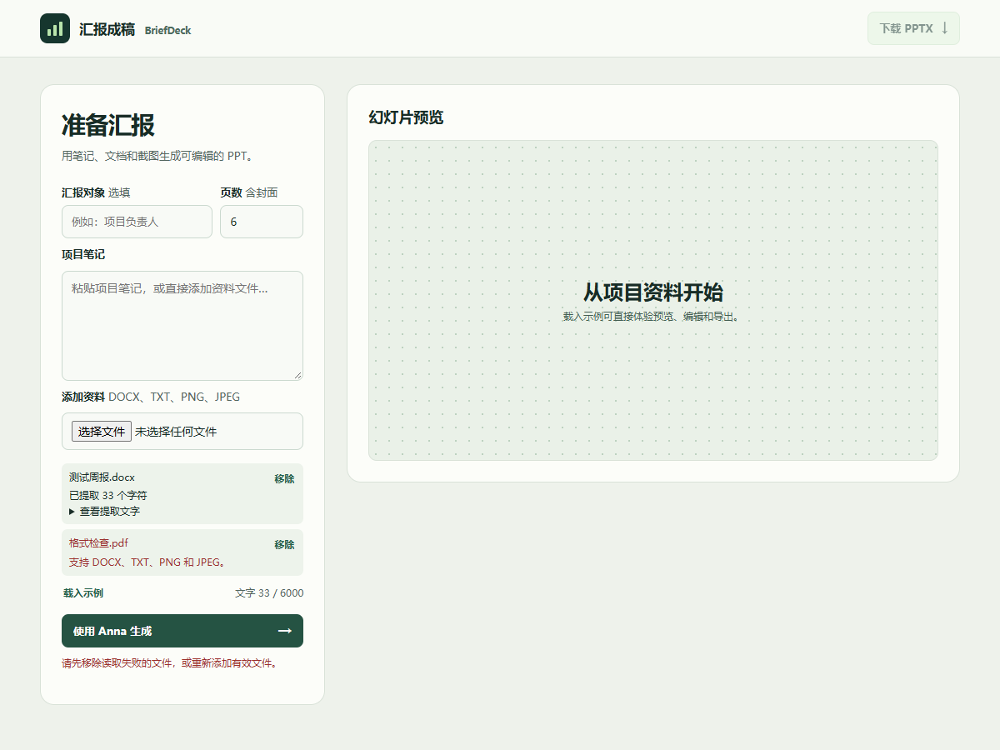 |
| M1.3 | 初次打开默认 6 页。依次输入 4、5、9、12 验证通过。逐键或整段输入小数、负数、字母，检查输入框旁立即提示。空值、3、13 立即提示，改回区间内整数后清除。提交时再次拦截。 | 单元与本地浏览器 | **当前通过。** ① 11 月 19 日原用例通过，覆盖点击生成后的拦截。 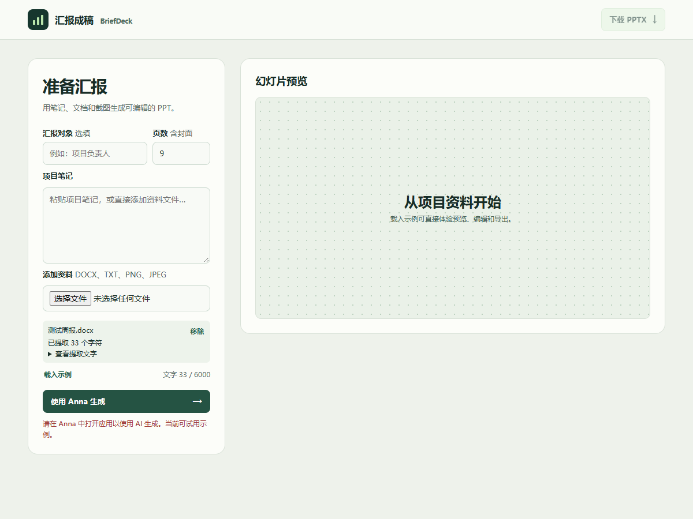  ② 同日用户发现输入时仍显示小数或负数，框旁无提示，即时校验 **不通过**。新增用例在旧版输入 4.5 立即失败。 ③ 修复后 **通过**。格式错误当场拒绝并保留原值，空值和越界立即提示，改为 12 后无残留错误。非法值提交没有模型请求。    |
| M1.4 | 键盘打开文件选择并添加 Word。入口可继续选择，列表正确显示已添加状态，无矛盾提示。移除后重新添加同名文件并成功读取。 | 本地浏览器与模拟 Anna | **当前通过，用户已确认。** ① 11 月 19 日修复前 **不通过**。用户复现「未选择任何文件」与「已提取」同时出现，Playwright 同样在原生文件框可见的断言处失败。  ② 同日修复后 **通过**。用 Enter 打开文件选择，添加、移除并重新选择同一个 Word，列表正确显示一条已读取记录，入口文案不再出现空状态。  ③ 用户仍在已打开的旧标签页看到原生控件。核对两个本地端口返回的页面均为新版，在新端口复测通过，用户随后确认通过。 |
| M1.5 | 添加 Word 与图片，默认只显示文件数量。用键盘展开、收起；收起时加入错误文件，检查自动展开和错误计数；移除错误文件后，收起列表生成并核对两份资料仍进入请求。移除全部文件后摘要消失。 | 浏览器与模拟 Anna | 11 月 19 日 **自动化通过**。折叠状态提交仍包含 Word 文字和图片。清空后摘要消失。    |
| M1.6 | 默认简约风和默认主色。切换科技风、自选主色并恢复默认。比较同一份稿件预览和导出，检查内容和版式保留，切换与下载均无模型请求。 | 浏览器、PPTX 文件、PowerPoint | **0.1.3 用户复核不通过，新版本地通过。** 用户选择 `#D7AB79` 后，实测 PPTX 封面仍为 `#142B45`、正文仍为 `#0B1527`，所选色只写入线条和标记。新版测试校验背景和卡片随主色变化。 检查了自选主色写入导出的形状。PowerPoint 实际打开两种风格，保留可编辑指标文字。新版科技风页眉装饰及深色卡片见 M4.4 桌面复测。   |

## M2–R1 生成到发布

| 规格 | 测试用例与预期 | 执行环境 | 验证 |
| --- | --- | --- | --- |
| M2.1 | 用模拟返回覆盖 4、5、6、9、12 页，验证封面、正文结构与长度。回传错误页数、截断、非法 JSON、额度不足、模型不支持图片和连接失败，检查保留输入和原稿。截断响应包含用量时，检查消耗和实际输出上限可见。 | 单元与浏览器 | **自动化通过。** 模拟截断保留了原稿和附件，显示了模拟消耗 14 CU 及实际输出上限 1500 tokens。此用例消耗 0 Anna 额度。 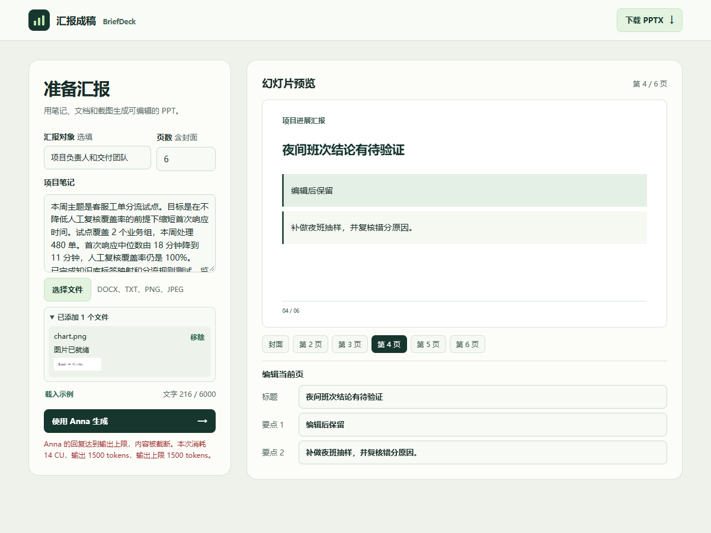 |
| M2.2 | 载入示例、预读附件、切换页、编辑、下载，检查模型调用数为零。模拟连续提交，检查仅一次调用。生成失败后等待，检查请求计数无变化。 | 浏览器与模拟 Anna | 自动化已通过。 |
| M2.3 | 使用 [混合样例](ACCEPTANCE-INPUT.md#m23-staging-混合资料)，选择 5 页。核对处理量、截图独有的指标、扩容状态与页数，记录余额前后值。 | Anna staging | **真实生成及文件检查通过，余额差值未记录。** ① 11 月 19 日普通下载返回 `App has no published version available`。CLI 创建 `0.1.0` 后补即时校验，并切出 `0.1.1`。 ② `0.1.1` 一次真实请求返回截断，未获得稿件，用户报告消耗 **14 CU**。   ③ 已切出带截断修复的 `0.1.2`，未进行真实复测。 ④ 已上传含最新编辑功能的 `0.1.3`，用户生成并导出 5 页。核对到 480 单、18→11 分钟、100% 复核和第 3 个业务组待决策。宿主回执为 25.272413793103443 CU、2988 输出 tokens、有效上限 3000，输入和推理用量未知。 |
| M2.4 | 首次生成的汇报中，关键指标、进展、风险和待决策页的标题及版式分别适配内容。核对 480 单、18→11 分钟和 100% 复核覆盖率，检查示例和生成稿使用同样的版式能力。 | 模拟宿主、浏览器、Anna staging | **0.1.3 用户视觉验收不通过，新版本地通过。** 实测复用了示例中的封面、指标、进展、风险和决策构图。新版用一条模拟请求让相同指标和文字显示在纵排中，同时校验默认布局。截图用量为模拟数据。 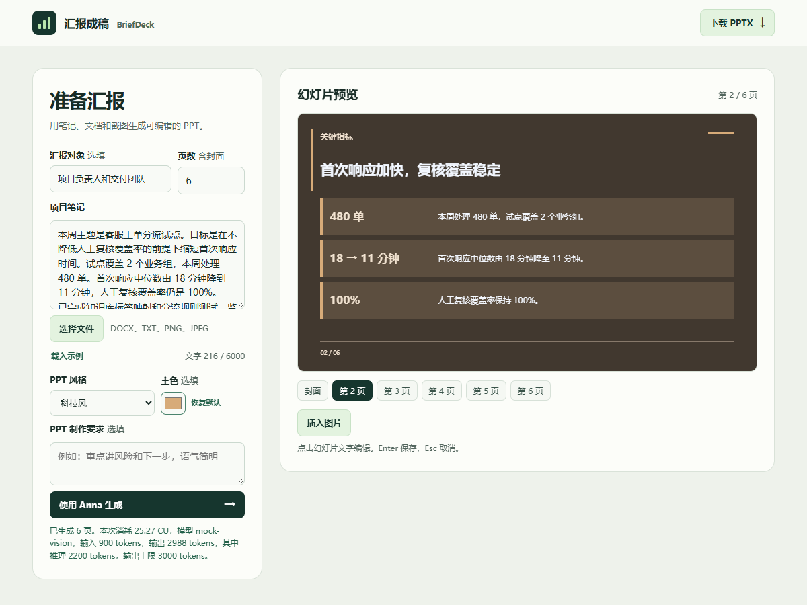 基线正文重复使用一种版式，用户复核不通过。新版在示例与模拟生成稿中共用不同版式。首次 PowerPoint 测试发现风险页主文本超出文本框 14.5 pt，缩小字号后复测 77 个文本框通过。 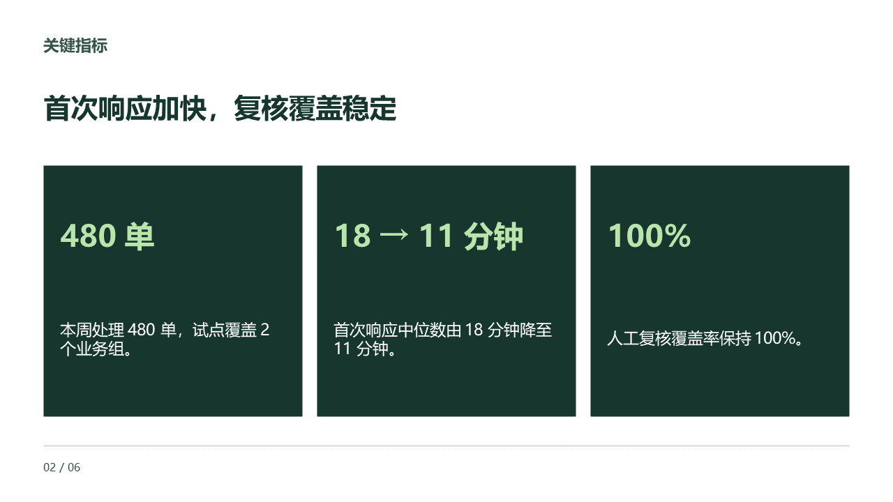   |
| M2.5 | 分别生成科技风和简约风，检查风格对应提示、实际主色、可选制作要求、资料与输出上限。切换风格和主色不发起请求。 | 单元、浏览器与模拟 Anna | **本地请求校验通过，0.1.3 用户用语气偏好真实生成成功。** 文件可见语气词和更活泼的表达。 ① 原版只发送可选制作要求，风格和主色仅作用于本地渲染。对照更新后的生成要求，此项 **不通过**。 ② 新版每次提交一次。科技风带量化对比指令、自选色及制作要求。简约风带单页聚焦指令、默认色，省略空制作要求。字数仍限制为 300。  |
| M3.1 | 分别检查 4 页与 12 页稿件的首尾页和页码。编辑末页，切走再切回，检查编辑值和预览一致。修改页数选择时当前稿件页数保持正确。 | 浏览器 | 自动化已通过。 |
| M3.2 | 在已修改稿件时取消生成和载入示例，检查原稿、输入、附件和调用数。检查无稿件时下载禁用。 | 浏览器 | 自动化已通过。 |
| M3.3 | 直接点击画布上的标题和要点进行编辑，用键盘进入编辑、保存与取消。切页后复核保存的修改仍在，取消的内容已还原。 | 浏览器 | **本地通过。** 基线从画布下方编辑，验收不通过。新版使用 Enter 保存、Esc 取消，也支持离开文字框保存。切页保留已经保存的修改，指标跟随要点更新。 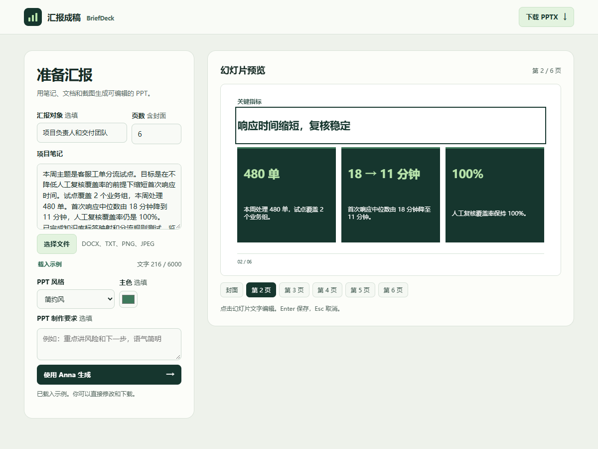 |
| M3.4 | 批量插入与调整多图，检查正文和指标、换页及换风格。混合有效、损坏、超限图片，保留有效图并提示错误。仅选中图显示右上角红叉，通过红叉或 Delete 删除单图。插入及删除后由画布显示结果。 | 单元与浏览器 | **本地通过。** ① 原用例的单图、替换和异常处理通过。用户复核发现每页只能插入一张、不能调整位置和大小，插图切换正文排版后指标大字可能消失。按更新后的用户验收要求判为 **不通过**。 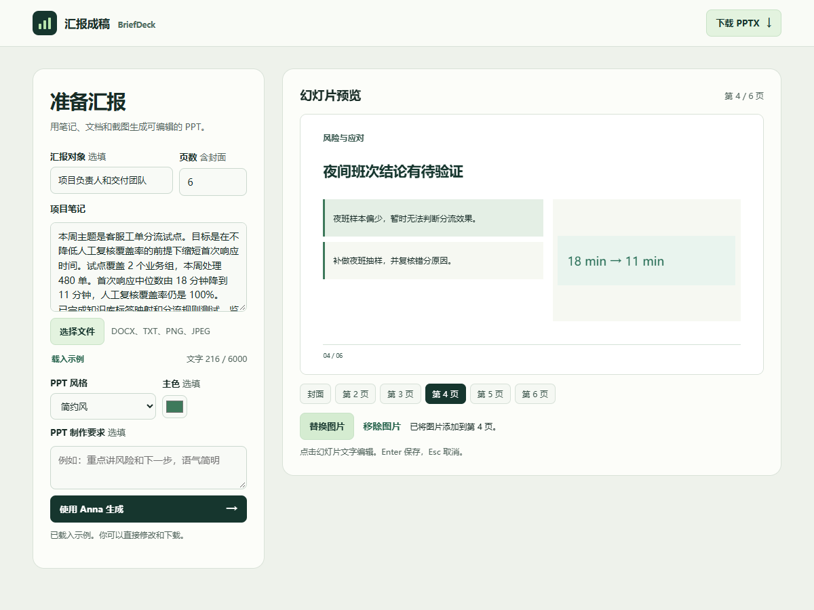 ② 多图版通过鼠标与键盘调整、错误处理及换页。用户复核发现分批插入仍显示上次批次张数，容易被读成总数，删除提示也持续显示，按新要求判为 **不通过**。  ③ 复测通过。插入和删除无成功提示。仅选中图显示红叉，点击或按 Delete 只删目标图片，重新导出保留其余图片。损坏与超限提示仍可见，全程 0 次模型请求。 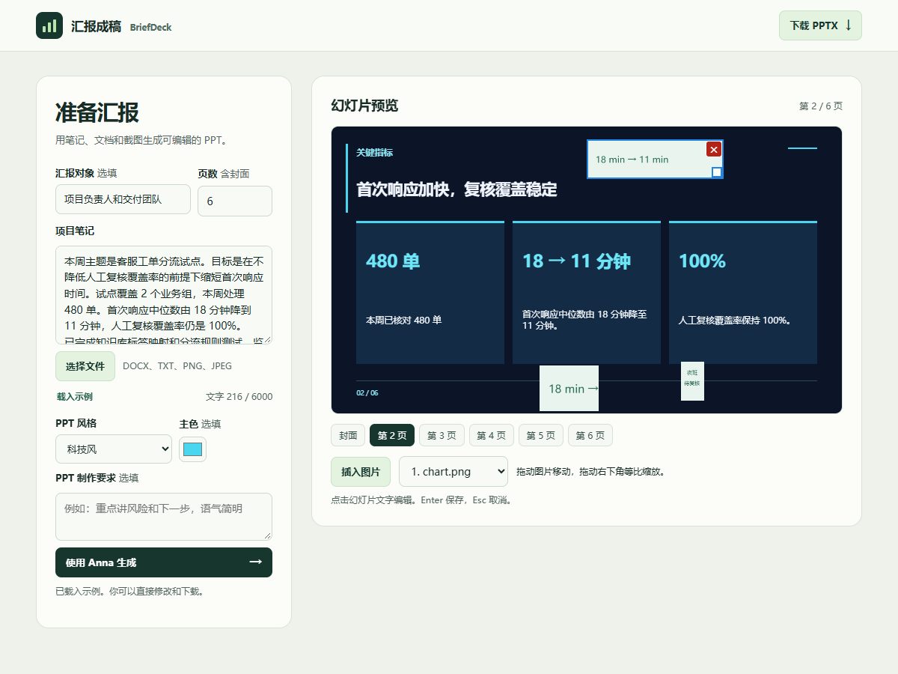 |
| M4.1 | 解析导出的 4、6、12 页 PPTX，检查页数和修改后的原生文本。用 PowerPoint 打开 staging 导出文件，再编辑并保存。模拟导出失败，检查提示及重试。 | 单元、浏览器、PowerPoint | **本地通过。** PowerPoint 实际打开 4、6、12 页测试文件，分别编辑最后一页文字、另存并重新打开，页数和修改均保留。staging 导出文件待 M2.3 产出。 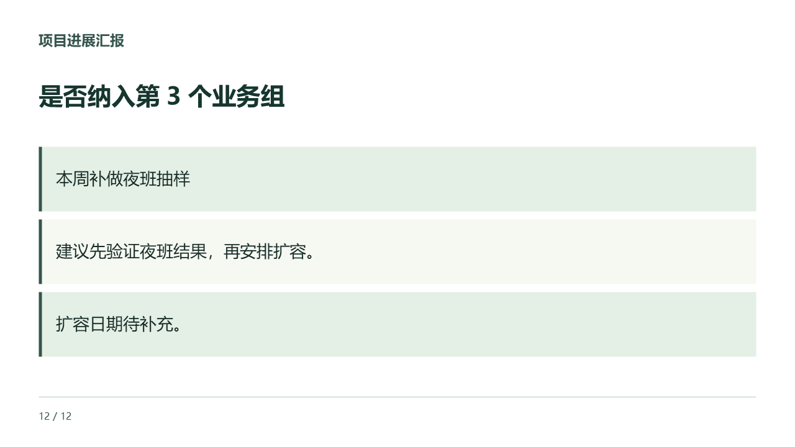 |
| M4.2 | 输入 28 字中文标题和 56 字要点，检查 480 px 与 1200 px 预览，以及 PowerPoint 中的换行和溢出。 | 浏览器、PowerPoint | **通过。** 浏览器两种宽度均已检查。用 PowerPoint 检查三份文件前两页共 30 个文本框边界，未发现溢出。截图文字按字数边界构造。   |
| M4.3 | 导出含多种版式的稿件，用 PowerPoint 对照封面、指标和风险或决策页。核对直接在画布上修改的文字进入文件且仍可编辑。 | 浏览器、PowerPoint | **本地通过。** 以示例为起点在画布修改副标题、指标页标题和数字，在 PowerPoint 实际打开浏览器下载的六页文件。标题与测试数字 492 单进入原生文本框，PowerPoint 二次修改后另存并重新打开成功。 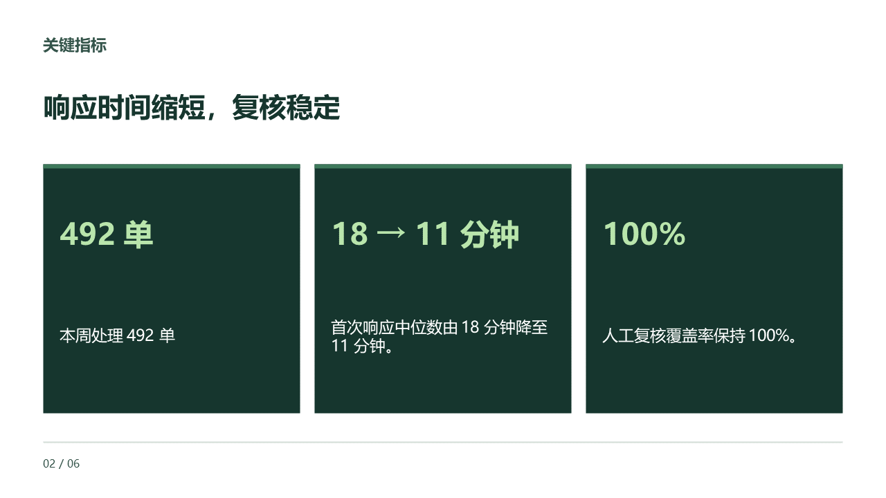 |
| M4.4 | 下载多图稿，核对图片数量、目标页、坐标和尺寸。验证图片和文字都是独立可编辑对象。移除单张后重新下载。 | 浏览器、PPTX 文件、PowerPoint | **本地通过。** ① 单图基线通过桌面验收。移动图片并另存后再打开，位置保留。  ② 多图版中，导出的图片坐标和尺寸与预览一致，移除一张后剩两张。PowerPoint 打开六页文件，第 2 页有三张原生图片对象和原生指标文本。移动其中一张，另外两张坐标保持不变。  |
| R1 | 校验构建包并上传。审核通过且发布后，从非开发者账号找到、打开 App 并检查使用入口。核对 GitHub 地址、App name 和 slug。 | Anna staging、GitHub | 已上传并核对 `0.1.4`（ID 685）安装入口，GitHub `main` 已同步 M5/M6。待完成新版示例验收、提审、公开发布及非开发者账号验证。 |

## M5 逐页设计

| 规格 | 测试用例与预期 | 执行环境 | 验证 |
| --- | --- | --- | --- |
| M5.1 | 同一指标文案允许两种坐标。客服试点用前后对比图，分阶段迁移用按日期排列的时间线。 | 单元、浏览器与模拟 Anna | **本地通过。** 实测了同一指标图从左侧移到底部。两份 4 页样例的第 2 页采用不同的原生对象和坐标。真实模型是否能产生适配资料的方案仍待验证。 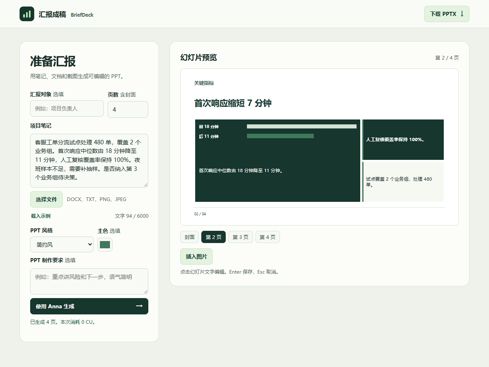 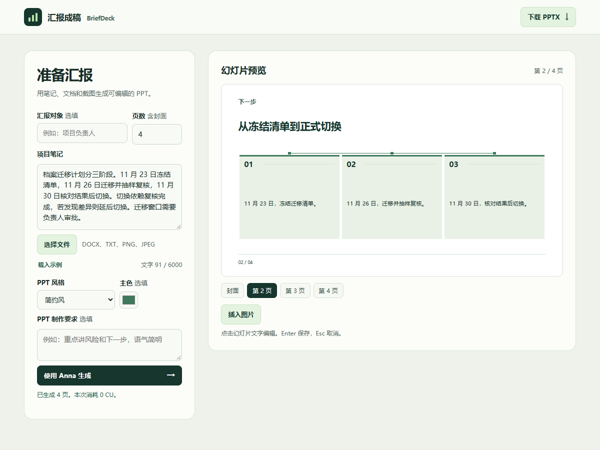 |
| M5.2 | 校验越界、重叠、重复引用和未知元素。编辑指标、添加图片及改变窗口宽度，再核对 PPTX。 | 单元、浏览器、PPTX XML 与 PowerPoint | **本地通过。** 非法设计回退为原语义版式，保留有效文案。18→12 分钟同步到对比条标签；导出同时保留独立图片。480 px 下检查了时间线正文。PowerPoint 实际打开两份 4 页文件，核对可编辑文本、原生形状和独立图片。无效稿件保留原稿见 M2.1。 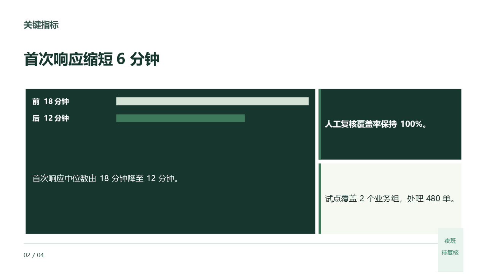 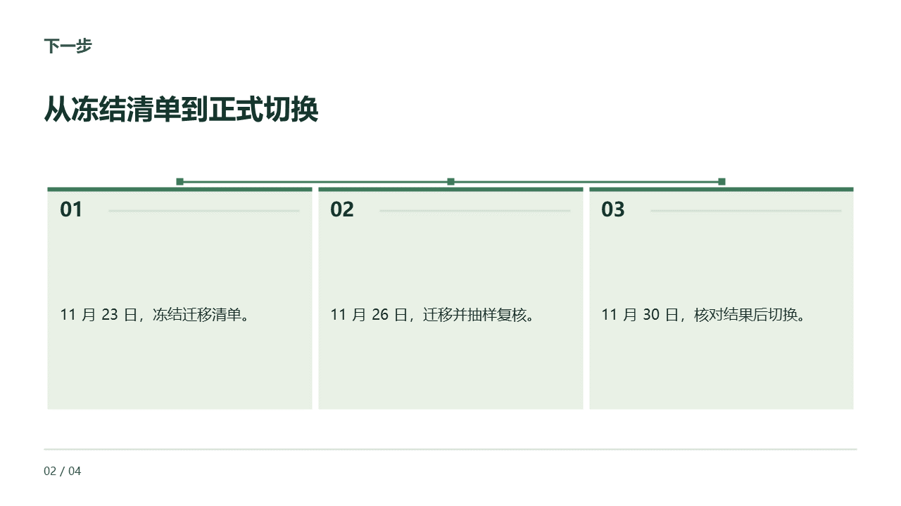 |
| M5.3 | 用暖金、高饱和色及黑白两端检查两套风格的文字对比度，比较背景与卡片色值。 | 单元、浏览器与 PPTX XML | 首次测试发现科技风自选白色时，卡片 `#73767A` 与正文 `#E8F1FF` 对比度不足，判为 **不通过**。调深卡片后，八个风格与主色组合的文字对比度复测 **通过**。PPTX 背景和装饰色回归通过。 |
| M5.4 | 检查每次点击的请求次数、超时或截断后是否重试、用量字段及编辑导出是否触发调用。 | 浏览器与模拟 Anna | **本地通过。** 两份样例分别发送一次，修改及下载无新增请求。连续点击、截断和用量字段由 M2.1、M2.2 回归覆盖。这次实测消耗 0 CU。 |

## M6 我的 PPT

| 规格 | 测试用例与预期 | 执行环境 | 验证 |
| --- | --- | --- | --- |
| M6.1 | 生成并编辑 4 页和 6 页两稿，设置各自的风格、主色和图片位置。切换及刷新后恢复其中一稿、导出并校验页数和原生图片。 | Chrome、模拟 Anna 存储与 PPTX XML | **本地通过。** 两份稿分别显示名称、页数和当前选择。刷新后 4 页稿恢复主题、主色和图片。切换、新建空白和导出发起 0 次模型请求。 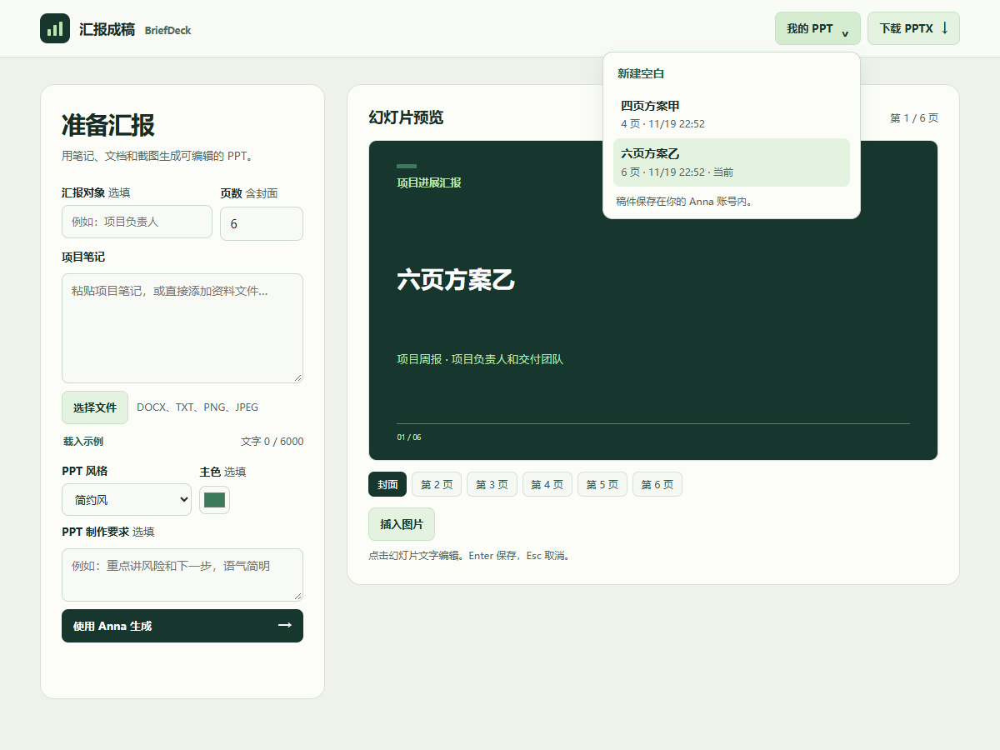 |
| M6.2 | 载入示例后列表为空。显式保存、模拟存储超限、新建空白、重新打开与下载。另验证本地预览用浏览器存储恢复。 | Chrome、模拟 Anna 存储、IndexedDB | **本地通过。** 存储失败时提示备份，稿件仍可在当前窗口使用。浏览器本地预览关闭并刷新后能打开已保存示例。Anna 宿主的存储链路待安装验收。 |
