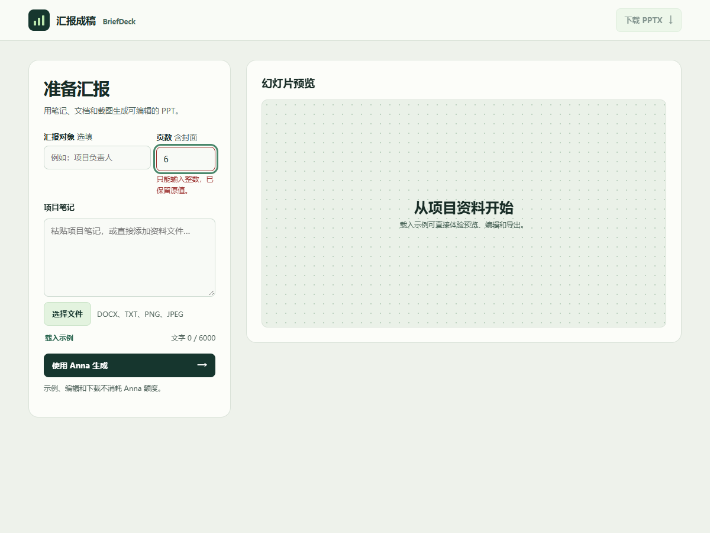
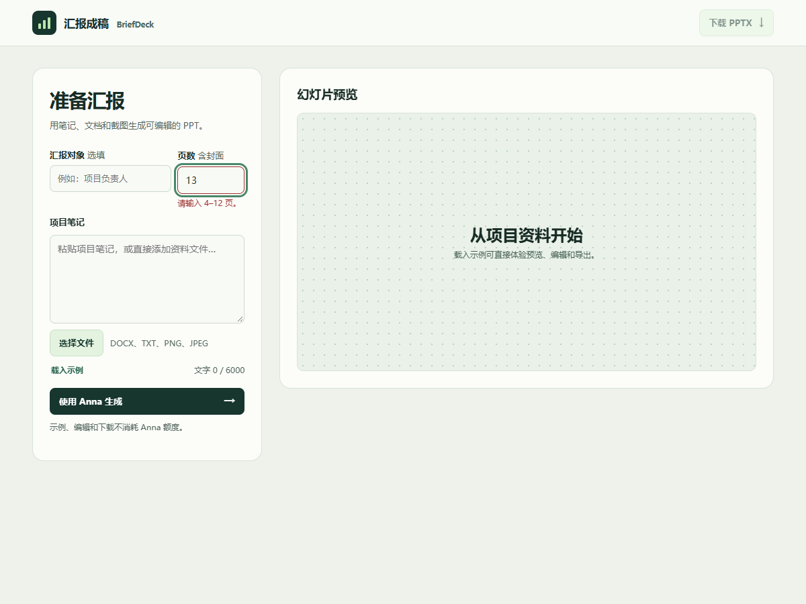
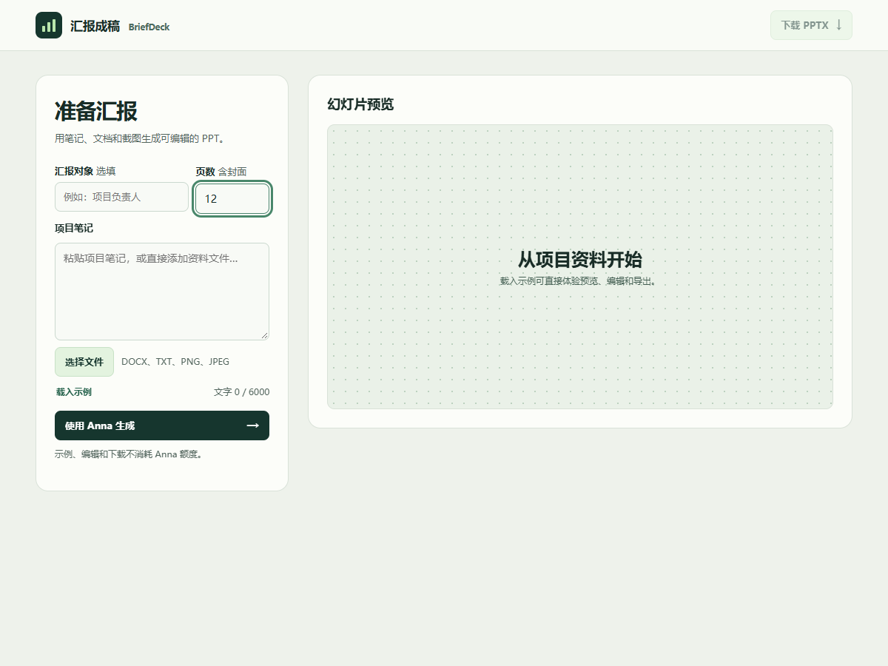
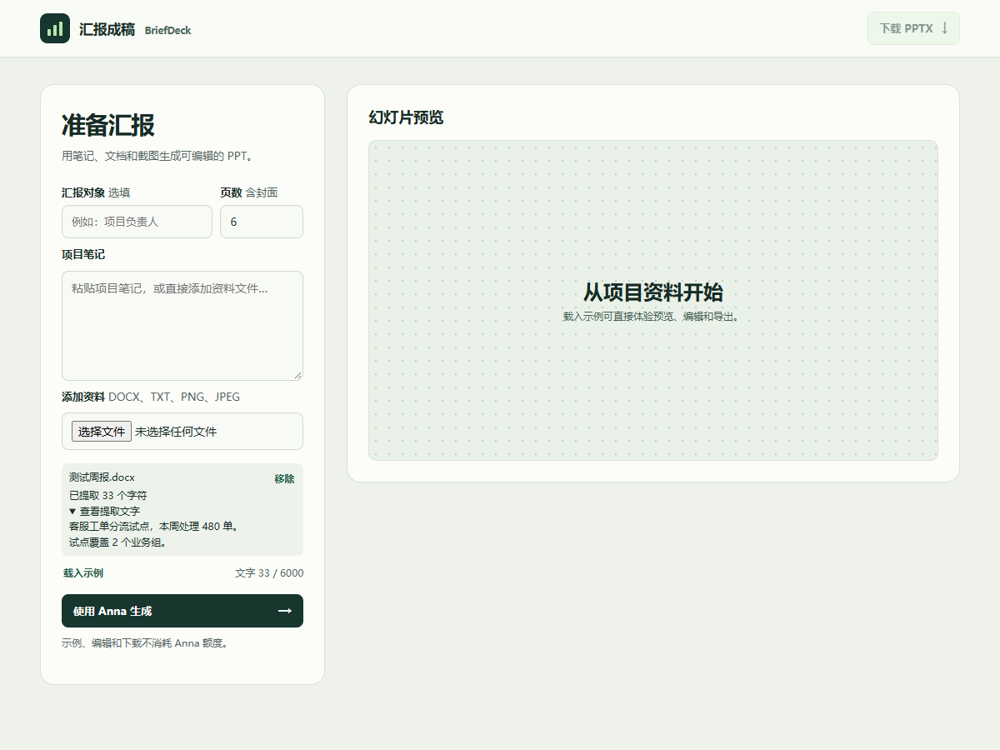
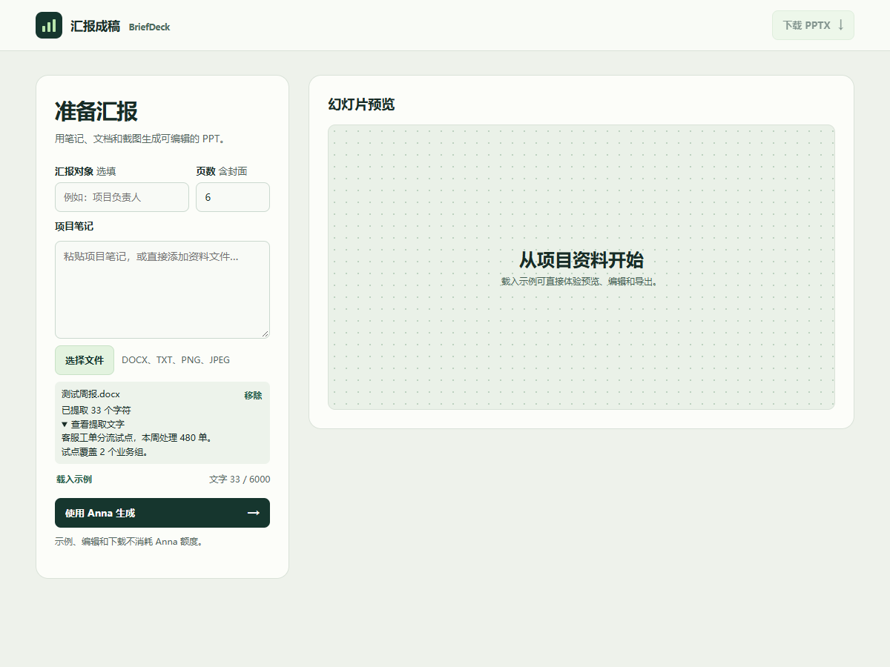
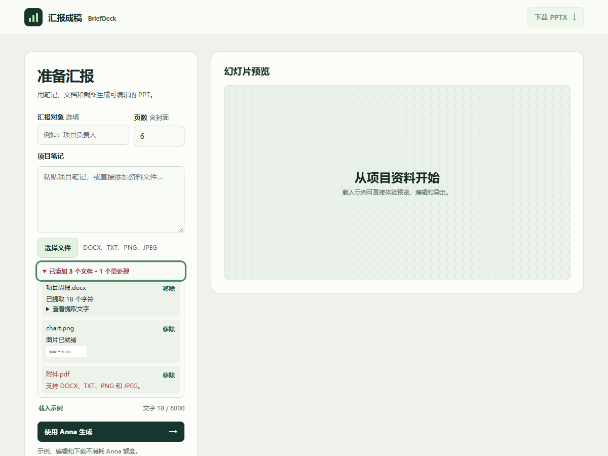

# BriefDeck 验收用例

以 [首版功能规格](../SPEC.md) 的编号为准。每项用例在验证栏内保留历次结果和截图。实际额度和发布状态写入 [交付记录](DELIVERY.md)。

## M1 资料输入与设置

| 规格 | 测试用例与预期 | 执行环境 | 验证 |
| --- | --- | --- | --- |
| M1.1 | 分别提交纯文字、仅 DOCX、仅 TXT、仅 PNG、仅 JPEG 及混合输入。检查文件预读、Word 段落和表格文字、图片缩略图、空汇报对象默认「项目组」，及请求中保留全部有效来源。 | 本地浏览器与模拟 Anna | **当前通过。** 11 月 19 日初测提取和请求通过，联合复核因文件状态冲突判为 **不通过**。修复后同一批输入重新通过回归，界面复测见 M1.4。 |
| M1.2 | 提交空资料、损坏 DOCX、空 TXT、损坏图片、PDF、超大文件、第三份同类文件和超长文字。检查错误位置与原因、请求数为零、移除出错文件后其他资料仍在。 | 本地浏览器与模拟 Anna | 11 月 19 日 **通过**。  |
| M1.3 | 初次打开默认 6 页。依次输入 4、5、9、12 验证通过。逐键或整段输入小数、负数、字母，检查输入框旁立即提示。空值、3、13 立即提示，改回区间内整数后清除。提交时再次拦截。 | 单元与本地浏览器 | **当前通过。** ① 11 月 19 日原用例通过，覆盖点击生成后的拦截。   ② 同日用户发现输入时仍显示小数或负数，框旁无提示，即时校验 **不通过**。新增用例在旧版输入 4.5 立即失败。 ③ 修复后 **通过**。格式错误当场拒绝并保留原值，空值和越界立即提示，改为 12 后无残留错误。非法值提交没有模型请求。    |
| M1.4 | 键盘打开文件选择并添加 Word。入口可继续选择，列表正确显示已添加状态，无矛盾提示。移除后重新添加同名文件并成功读取。 | 本地浏览器与模拟 Anna | **当前通过，用户已确认。** ① 11 月 19 日修复前 **不通过**。用户复现「未选择任何文件」与「已提取」同时出现，Playwright 同样在原生文件框可见的断言处失败。  ② 同日修复后 **通过**。用 Enter 打开文件选择，添加、移除并重新选择同一个 Word，列表正确显示一条已读取记录，入口文案不再出现空状态。  ③ 用户仍在已打开的旧标签页看到原生控件。核对两个本地端口返回的页面均为新版，在新端口复测通过，用户随后确认通过。 |
| M1.5 | 添加 Word 与图片，默认只显示文件数量。用键盘展开、收起；收起时加入错误文件，检查自动展开和错误计数；移除错误文件后，收起列表生成并核对两份资料仍进入请求。移除全部文件后摘要消失。 | 浏览器与模拟 Anna | 11 月 19 日 **自动化通过**。折叠状态提交仍包含 Word 文字和图片。清空后摘要消失。    |

## M2–R1 生成到发布

| 规格 | 测试用例与预期 | 执行环境 | 验证 |
| --- | --- | --- | --- |
| M2.1 | 用模拟返回覆盖 4、5、6、9、12 页，验证封面、正文结构与长度。回传错误页数、截断、非法 JSON、额度不足、模型不支持图片和连接失败，检查保留输入和原稿。截断响应包含用量时，检查消耗和实际输出上限可见。 | 单元与浏览器 | **自动化通过。** 模拟截断保留了原稿和附件，显示了模拟消耗 14 CU 及实际输出上限 1500 tokens。此用例消耗 0 Anna 额度。  |
| M2.2 | 载入示例、预读附件、切换页、编辑、下载，检查模型调用数为零。模拟连续提交，检查仅一次调用。生成失败后等待，检查请求计数无变化。 | 浏览器与模拟 Anna | 自动化已通过。 |
| M2.3 | 使用 [混合样例](ACCEPTANCE-INPUT.md#m23-staging-混合资料)，选择 5 页。核对处理量、截图独有的指标、扩容状态与页数，记录余额前后值。 | Anna staging | **目前不通过。** ① 11 月 19 日普通下载返回 `App has no published version available`。CLI 创建 `0.1.0` 后补即时校验，并切出 `0.1.1`。 ② `0.1.1` 一次真实请求返回截断，未获得稿件，用户报告消耗 **14 CU**。   ③ 已切出带截断修复的 `0.1.2`，待一次真实复测。 |
| M2.4 | 首次生成的汇报中，关键指标、进展、风险和待决策页的标题及版式分别适配内容。核对 480 单、18→11 分钟和 100% 复核覆盖率，检查示例和生成稿使用同样的版式能力。 | 模拟宿主、浏览器、Anna staging | **基线不通过。** 用户复核发现正文复用同一种版式，示例缺乏真实汇报的重点。多版式生成待实现。 |
| M3.1 | 分别检查 4 页与 12 页稿件的首尾页和页码。编辑末页，切走再切回，检查编辑值和预览一致。修改页数选择时当前稿件页数保持正确。 | 浏览器 | 自动化已通过。 |
| M3.2 | 在已修改稿件时取消生成和载入示例，检查原稿、输入、附件和调用数。检查无稿件时下载禁用。 | 浏览器 | 自动化已通过。 |
| M3.3 | 直接点击画布上的标题和要点进行编辑，用键盘进入编辑、保存与取消。切页后复核保存的修改仍在，取消的内容已还原。 | 浏览器 | **基线不通过。** 当前从画布下方的字段编辑文字，画布上的直接编辑待实现。 |
| M4.1 | 解析导出的 4、6、12 页 PPTX，检查页数和修改后的原生文本。用 PowerPoint 打开 staging 导出文件，再编辑并保存。模拟导出失败，检查提示及重试。 | 单元、浏览器、PowerPoint | **本地通过。** PowerPoint 实际打开 4、6、12 页测试文件，分别编辑最后一页文字、另存并重新打开，页数和修改均保留。staging 导出文件待 M2.3 产出。  |
| M4.2 | 输入 28 字中文标题和 56 字要点，检查 480 px 与 1200 px 预览，以及 PowerPoint 中的换行和溢出。 | 浏览器、PowerPoint | **通过。** 浏览器两种宽度均已检查。用 PowerPoint 检查三份文件前两页共 30 个文本框边界，未发现溢出。截图文字按字数边界构造。   |
| M4.3 | 导出含多种版式的稿件，用 PowerPoint 对照封面、指标和风险或决策页。核对直接在画布上修改的文字进入文件且仍可编辑。 | 浏览器、PowerPoint | 待实现。 |
| R1 | 校验构建包并上传。审核通过且发布后，从非开发者账号找到、打开 App 并检查使用入口。核对 GitHub 地址、App name 和 slug。 | Anna staging、GitHub | 待新版发布。 |
