# BriefDeck 测试与验收

## 验证基线与结论口径

功能基线为Anna staging开发测试版 **0.1.17（ID701）**。本地自动化于2026-11-20运行：**57项单元、48组浏览器全部通过，无失败或跳过**；Anna严格包校验通过。线上记录覆盖2026-11-19至11-20、版本0.1.6–0.1.17，使用虚构企业办公资料；其中T05明确在0.1.17完成真实复测。

- 自动化验证：固定输入、mock Anna回执、精确断言，可重复运行，不消耗真实模型积分。
- 线上验证：产品负责人提供的真实操作总结，验证平台调用、资料理解、实际生成及导出；历史回放与真实调用分别登记。
- 原生文件验证：PPTX内部对象检查与历史PowerPoint人工复核分别记录，不把结构检查当作所有Office环境逐框验收。
- 发布验收：单独按R1追踪平台审批、发布和跨账号操作，不用开发者安装结果替代正式访问结论。

完整线上原始Markdown保留本地；本节归纳实际完成的场景和检查项。原始响应、截图、回执只有在实际取得时才作直接证据，不补造字段或费用。后续补充资料按原编号更新相应用例。

## 测试策略与覆盖矩阵

测试按风险分层：输入边界先于模型调用校验；内容和设计采用正反例；编辑与并发检查状态隔离；预览、存储和PPTX检查端到端一致性；真实Anna验证模型行为。覆盖格式、数量、语义、密度、状态和输出多个维度，而非只验证一次成功生成。

| 验证层 | 覆盖维度与代表场景 | 主要证据 |
| --- | --- | --- |
| 输入与设置 | 文字、DOCX、TXT、PDF、PNG/JPEG；混合输入；损坏/加密/扫描/空文件；大小、文档/图片数量、文字总量；4–12页整数与即时提示；3文件提示显隐。 | M1、M8；deck单元与浏览器源文件用例 |
| 整稿协议 | 指定页数、封面单副标题、正文非空数组、JSON/类型/控制字符/异常体积；可选字段兼容；完整内容和原稿保护。 | M2、D1；真实JSON回放、解析单元 |
| 推理与调用控制 | 动态预算；明确maxTokens最多1次重试；模型/通道硬限制停止；其他错误不自动重试；取消/过期/迟到回执。 | G1；generation-operation单元、浏览器专项 |
| 数据关系与来源 | 单值、前后比较、完成量/总量、当前/目标；单位/来源/顺序；零基线、零总量、超额完成、不同单位、无关百分比反例。 | V1、V2、C1；metric与兼容性回归 |
| 内容与视觉语义 | 结论型标题、口径与限制、因果表述约束；角色—职责、明确连续步骤与独立补充、普通清单；主证据及辅助关系。 | P1、P1G、V2；真实内容及模拟设计分别记录 |
| 可读性与完整性 | 1–6条长中文及更多短要点；密度/字号/换行；01起连续编号；越界/重叠/非法设计回退；480px与1200px。 | D1、D1.8、M4.2；浏览器及历史原生检查 |
| 用户操作与恢复 | 文字编辑/取消/未离焦提交，多图拖动/缩放/删除；P2切换/撤销/恢复；多稿保存、重开、删除及存储冲突。 | M3、M6、P2；browser与library回归 |
| 单页AI设计 | 1/2/3/4次成功即停、4次失败、不可修复提前停止；授权、预览确认、取消、过期；其他页与图片隔离。 | P2.5；redesign单元及浏览器mock |
| 积分及普通界面 | 原回执精确累计后两位显示；未知回执待确认；0.104×2→0.21，×4→0.42；隐藏模型/token及开发诊断。 | G1、P2.5；公共界面与精确求和断言 |
| 导出与宿主 | 实际下载PPTX、页数、完整文字、独立文本/形状/图片和坐标；历史PowerPoint开文件/编辑/另存；Anna真实多文件生成。 | M4、T01–T09、原生截图和XML检查 |

覆盖矩阵说明“验证了什么”，不计算没有测量依据的覆盖率，也不将所有历史场景归为最终版本重跑。测试结果按下面的自动化基线、线上场景及历史证据分别阅读。

## 可复现自动化结果

| 检查 | 执行与结果 |
| --- | --- |
| 单元回归 | npm test，57/57通过。[完整日志](evidence/correction/unit-0.1.17-final.tap)。覆盖解析、数值/来源、安全回退、密度、历史、P2/P2.5、预算、状态与积分。 |
| 浏览器回归 | npm run test:browser，48/48通过。[完整日志](evidence/correction/browser-0.1.17-final.tap)。实际浏览器、沙箱iframe和下载链路，Anna SDK经路由mock。 |
| 构建与严格包校验 | npm run build以及Anna CLI validate --bundle release/bundle --strict通过；17个bundle源文件与构建对应文件一致。 |
| 真实调用边界 | 上述自动化不调用付费Anna；线上测试单列，不把mock用量当作真实扣费。 |

本地运行及浏览器安装方式见[README](../README.md#测试)。历史原生Office脚本需Windows PowerPoint和对应本地导出文件，不作为所有环境的必备测试依赖。

## 线上场景验证

来源：产品负责人提供的《BriefDeck线上测试总结》，日期2026-11-19至11-20（北京时间），虚构企业办公资料。以下T01–T09对应原始记录01–09，保留原场景及真实调用/回放区别；仅T05明确为0.1.17最终候选复测，其余属于记录范围内的阶段验证。

| 编号 | 场景与输入 | 已完成的验证 | 结果口径 |
| --- | --- | --- | --- |
| T01 | 企业内部工单系统优化；纯文字、4页 | 4页结构及汇报生成流程。 | 真实生成完成；只归纳已确认的生成与页数结果。 |
| T02 | 跨部门协作机制优化；DOCX+TXT、6页 | 跨文档组织、六项问题、角色职责与四项机制；PPTX对象保留全文。 | 真实生成完成；不将生成完成扩大为逐框视觉验收通过。 |
| T03 | 档案数字化迁移；PDF+PNG、6页 | 9,600/12,000=80%，8→2分钟，99.2%与99.5%目标关系。 | 真实内容检查通过。 |
| T04 | 新员工导师制；JPEG+文字、8页 | 图片与文本组合、角色/流程、拟议方案状态，“待安排/待确认/待设计”保留。 | 真实内容检查通过。 |
| T05 | 企业知识库上线前验收；DOCX+PDF+PNG、6页 | 不混淆索引完成、测试通过、搜索准确率；权限待办、12项问题/3项高优先级与暂不发布建议；渲染可读及PPTX产出。 | **0.1.17真实复测通过**；结果来自线上总结。 |
| T06 | 客服工单智能分流；文字、6页 | 负责人叙事、18→11分钟、480单、风险；完整结构化响应用于回归。 | 真实生成完成，后续使用保存的真实JSON回放。 |
| T07 | 档案迁移指标关系；实际生成稿及模拟参数 | 8→2分钟约75%、9,600/12,000份和80%进度；关系与原文保留。 | 实际内容与模拟设计回放共同验证，未将模拟lead/design认定为真实返回。 |
| T08 | 导师制四阶段长文；保存的真实响应 | 四阶段完整保序，编辑、保存及PPTX回归。 | 真实响应本地回放通过，不新增线上调用。 |
| T09 | 风险页AI重新设计；在线候选 | 真实操作取得新布局，设计校验及原稿保护也经回归检查。 | 真实设计尝试完成；不推断该次使用了最终自动纠错机制或其具体次数。 |

### T05最终候选复测

同一知识库三文件、6页场景在0.1.17成功生成PPTX，记录确认以下事实：

- 索引完成：1,080/1,200=90%；测试通过：108/120=90%，二者不混淆。
- 搜索准确率86%，阶段目标90%；12项待处理问题中3项高优先级。
- 文档权限仍是上线检查项，保留暂不正式上线的建议。

该结果验证一次同条件真实生成与可读产出；是否实际发生受控重试、使用何种最终模型及本次精确用量，以原始平台回执为准，不从成功结果反推。

### G1回归与普通界面

mock覆盖强制推理3459 tokens占用3600输出预算并返回maxTokens的情况、首次成功、一次重试成功、两次截断停止、硬限制停止、其他错误不重试及取消后迟到；正文和旧稿保持。

积分先精确求和再格式化：内部0.208显示0.21，0.416显示0.42，31.40172413793103显示31.40，0.1+0.2显示0.30，未知回执标待确认。整稿和P2.5均不向普通用户显示模型/token等信息。

### M1.7多文件提示

浏览器mock验证0/2文件隐藏，添加第3个显示约定提示，移除至2个隐藏；页数仍为6，发起请求0次。此项已包含在最终48组浏览器回归中。

## 规约与自动化入口

验收编号与现行SPEC保持一致，相关用例允许共同验证多项契约；不将同一断言重复计算为独立覆盖率。下表提供代码入口，具体运行结果以上述完整日志为准。

| 规约编号 | 主要用例入口 | 验证方式 |
| --- | --- | --- |
| M1.1–M1.7、M8.1–M8.2 | [deck](../test/deck.test.mjs)、[browser](../test/browser.test.mjs)中的资料/页数/PDF及multi-file hint用例 | 输入正反例、读取状态、混合提交、显隐与0请求断言 |
| M2.1–M2.5、G1.1–G1.5 | [generation-operation](../test/generation-operation.test.mjs)、deck、browser的whole-deck controlled/ordinary UI | 协议、Prompt、动态预算、上限、重试次数、取消及精确积分 |
| M3.1–M3.4、M4.1–M4.4 | deck、browser对应M3/M4和下载用例 | 原位编辑、多图、页数/原文/坐标/PPTX对象；历史Office人工证据独立保留 |
| M5.1–M5.4、P1.1–P1.4、P1R.1–P1R.4 | deck、browser的P1/M5及真实JSON回放 | 有效/非法设计、重点、口径、因果Prompt、共享排版 |
| M6.1–M6.3 | deck、browser的多稿保存/恢复/删除/存储分支 | Anna mock存储及本地IndexedDB、冲突保护、其他稿隔离 |
| P1G.1–P1G.4、V1.1–V1.7 | deck、[compatibility](../test/compatibility.test.mjs)、browser的V1系列 | 严格数值关系、原文来源、编辑失效、原生导出 |
| V2.1–V2.5、C1–C2 | compatibility、deck、browser的V2/C4系列 | 角色职责、连续步骤/独立补充、等价表达与反例、诊断和局部辅助图 |
| D1.1–D1.8 | deck、browser的D1/D1.8系列 | 1–6条密度及更多短要点、完整原文、四阶段顺序、编号和回退 |
| P2.1–P2.4 | deck、browser的P2系列 | 兼容候选、未离焦编辑、切换/撤销/恢复及持久化 |
| P2.5.1–P2.5.6 | [redesign](../test/redesign.test.mjs)、[redesign-operation](../test/redesign-operation.test.mjs)、browser的P2.5系列 | 当前页隔离、四次上限、严格校验、预览确认、迟到响应、历史及积分 |
| R1.1–R1.4 | 平台查询、严格包校验及发布后人工免费冒烟 | 按下表逐项登记，跨账号结果不由本地mock推断 |

## 规约追溯与发布验收

现有M1–M8、P1/P1R/P1G、V1/V2/C、D1、P2/P2.5和G1编号保留，覆盖范围见上表，具体操作、反例及历次证据见下方历史验收。新增规约应继续复用对应编号，避免仅添加描述而没有用例。

| 发布项 | 当前状态与验收证据要求 |
| --- | --- |
| R1.1 应用/版本/仓库 | 既有应用280，0.1.17/ID701，已上传ready；GitHub功能基线已核对。 |
| R1.2 平台审批与发布 | 审核候选0.1.17，最近状态pending_review；平台返回与发布时间在审批完成后登记。 |
| R1.3 跨账号免费冒烟 | 按已发布版本执行安装、打开、示例、换页、编辑、P2、保存和PPTX下载打开；结果在执行后登记。 |
| R1.4 交付字段 | 仓库zhangkeyaoo/anna-briefdeck，App name汇报成稿 BriefDeck，slug briefdeck，完整标识@keyzhang/briefdeck。 |

## 历史验收与复测证据

以下保留原有用例、已修复失败、截图与回执，供复现和追溯。每段记录对应当时版本/约束；当前行为按[SPEC](../SPEC.md)判定，旧“单次请求/固定字数/可见诊断”等不覆盖G1/D1/P2.5。历史费用可能在多个说明中引用同一次调用，不能直接全文相加。

<details>
<summary>展开历次验收、失败复现与复测截图</summary>

## P2.5最终受控纠错与积分展示（0.1.16）

本节覆盖下方早期“一次调用、不自动纠错”的产品约束；旧失败与截图不删除。当前一次用户授权最多4次，每次可能计费；本轮所有响应均为mock，真实Anna调用0次、实际消耗0积分。

| 验收 | 结果与证据 |
| --- | --- |
| 第1/2/3/4次成功即停止 | **通过。** 分别验证1/2/3/4次complete调用；2/3次请求包含累计原始设计及实际错误，第三次可换策略。第4次仅允许模型原样选择compatibleProposals，不在客户端自动套模板。最后仍先预览，未确认前原deck不变。 |
| 具体校验错误与安全约束 | **通过。** inspectSlideDesign与parseSlideDesign共用同一接受规则；实际失败为第2元素高度4<5时，反馈明确元素、索引、实际高度和最小高度。最小尺寸、越界、重叠、原文、顺序、图片遮挡校验未放宽。第4次返回新自由网格会拒绝，不作为替代方案成功。 |
| 四次失败、不可修复、无策略 | **通过。** 四次无效停止；受保护字段/代码、网络请求错误提前停止；有面积下界证明网格不可能且没有不同兼容方案时0请求终止。无可行第4次策略时提前停止。失败关闭后日志保持failed，不误记用户取消。<details><summary>普通用户友好失败（示例0.4积分为mock回执累计）</summary></details> |
| 取消、过期及迟到响应 | **通过。** 首次及第三次请求期间取消/过期后均不发起下一次；迟到回执仅补记本次消费。操作独立ID，原页/风格签名仍有效才可显示或应用候选，不覆盖其他页。新操作在旧请求结束前不能混入。 |
| 累计积分1:1展示 | **通过。** 0.1+0.2+0.3+0.4显示总1积分，0.1+0.2显示0.3积分；保留0.10258620689655172原数值及科学计数法等价十进制，不四舍五入、不换算。缺消费回执明确待平台确认，不当成0。整稿生成仍是原单次链路，用量也只显示当前累计积分。<details><summary>有效候选与累计积分</summary>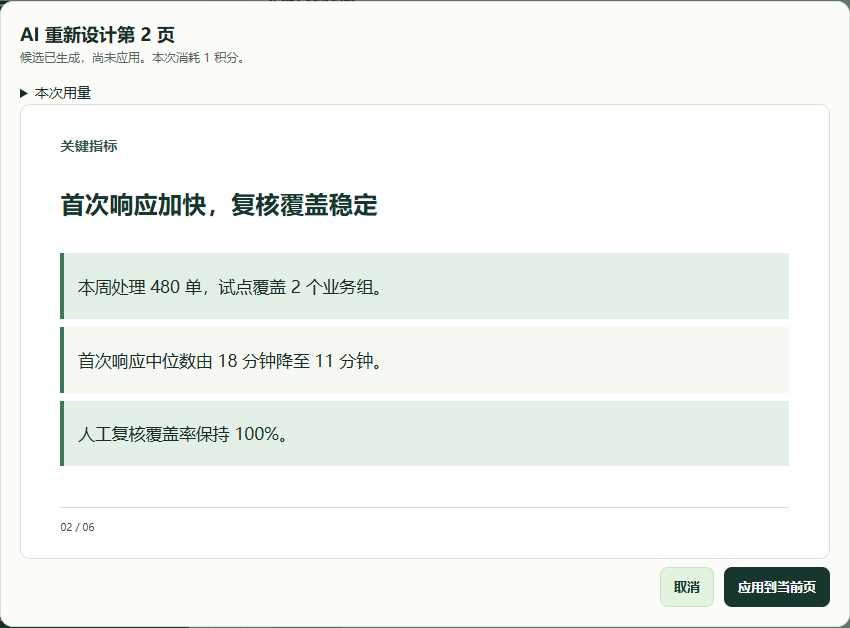</details> |
| 普通UI隐藏诊断 | **通过。** 普通模式隐藏布局日志、原始失败诊断、模型名、token/推理token/输出上限和重试过程；统一加载文案。debug=1可见开发面板，App iframe控制台window.briefdeckDiagnostics()仍可读取完整记录。逐次成功/失败/取消、原始输出、用量及具体原因保留；已确认操作随稿保存，未确认最近操作仅保留在当前会话。<details><summary>普通用户候选预览</summary>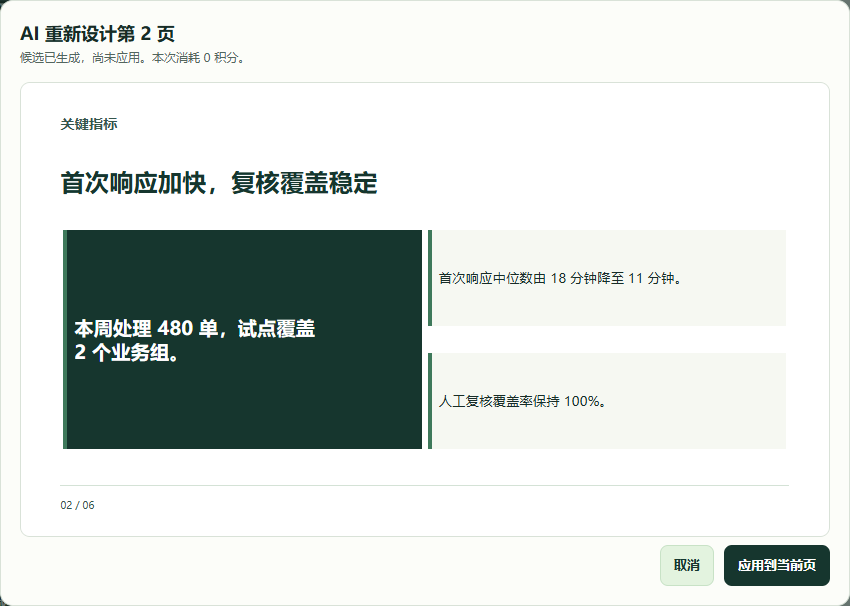</details> |
| 确认、P2、撤销、恢复、图片与导出 | **通过。** 第四次替代候选确认后，4次回执和总积分随稿保存，其他五页deepEqual，正文完整；撤销恢复原deck。旧候选确认、图片字节/位置、保存刷新恢复、原生PPTX文字/形状/图片导出，以及历史稿/P0/角色/流程/指标回归均通过。 |

**完整回归：52项单元、46组浏览器、Anna严格包校验通过。** 新增成功/失败/关闭/取消/普通积分显示专项也通过。运行记录：[单元](evidence/correction/unit-final.tap)、[完整浏览器](evidence/correction/browser-final.tap)、[专项](evidence/correction/targeted-final.tap)。首轮两次回归分别发现普通截断提示仍含“输出上限”和旧测试仍等“额度不足”；前者改为友好提示，后者按新积分名称更新，旧执行文件保留在release/correction/中，未降低安全断言。

修改集中于bundle/redesign-operation.js（新增驱动/累计积分）、bundle/redesign.js（校验错误属性）、bundle/slide-design.js（同一规则的具体错误）、bundle/app.js/index.html（统一加载、确认、积分和隐藏入口）、bundle/diagnostics.js（持久化逐次记录展示）；新增test/redesign-operation.test.mjs并更新既有浏览器/测试入口。没有改模型配置、整稿生成请求、排版能力、图片处理或导出架构，不增加依赖或生图。

**交付边界：** mock证明状态与保护机制，不证明真实Anna四次内一定能给出优质候选；失败也可能产生积分。缺回执时只能待平台核对。开发测试版上传按用户持续授权进行，正式发布未执行；下一次付费验证仍由用户明确操作确认。功能至此冻结，不再扩展。

## P2.5 AI单页重新设计（开发测试版0.1.14）

**上传更新：** 用户准备真实测试后，已按授权上传0.1.14（ID695，rev16，26文件5135.4KB，ready），上传过程0次模型调用、0 CU，未正式发布。以下“未上传”保留本地阶段记录；真实Anna候选质量、协议遵循率及实际费用仍待验证。建议使用已有保存稿的一个正文页，只进行一次确认调用，保留布局日志及导出文件。

**用户追加的界面收简已落实：** 原页说明、成功状态和技术用量堆叠较密；现改为一行AI提示、短操作结果及短布局卡片说明。模型名/tokens/完整用量进入折叠“本次用量”及可下载布局日志；最近一次取消/失败也有临时日志，已确认回执仍持久保存。付费确认、错误原因、原稿保留状态及编辑快捷键不删减。PPT内容/排版不变。界面专项6组回归通过，断言主成功提示及候选提示不含模型名/tokens，日志仍有原始模型和完整用量；随后另复测错误/取消路径。<details><summary>说明收简前后</summary>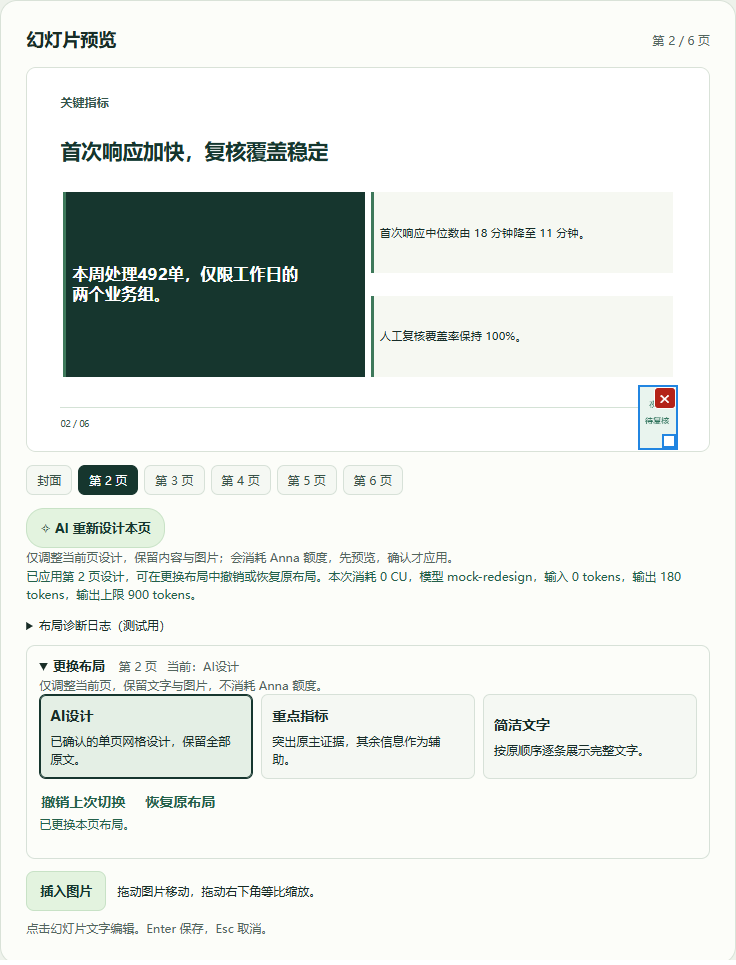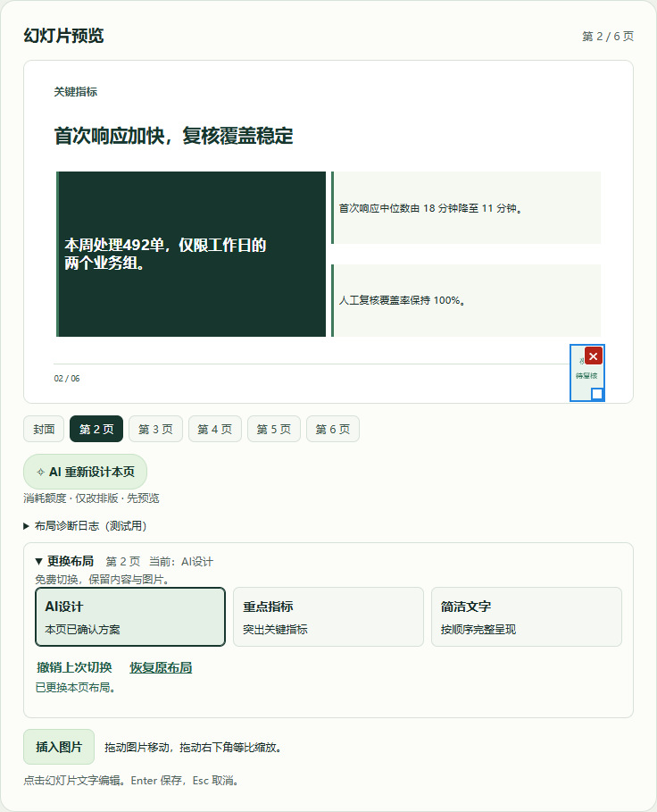</details>

整体结果：42项单元及43组全量浏览器回归通过；界面收简另做专项回归。构建与Anna严格包校验通过；PowerPoint六页36文本框、1张图片核对及原生编辑通过。所有模型响应均为mock，0次真实调用、0 CU；未上传staging。

本轮只使用mock Anna，不调用真实付费模型，消耗0 CU。模型响应为测试网格，不代表真实Anna已能稳定选出更好的设计；实际协议遵循率、视觉改进和成本均待用户后续确认测试。正式整稿生成链路、模型选择及其额度配置不变；新单页调用单次输出上限900 tokens、thinking:false。

| 用例 | 验证范围 | 结果与证据 |
| --- | --- | --- |
| P2.5.1 范围与计费 | 当前页入口与页码、正文/图片保护，先提示额度再调用，单次请求，无自动重试。 | **通过。** 封面明确禁用；打开确认框或在调用前取消均0请求。请求包含当前页完整已编辑正文、语义/兼容选项、几何及图片框，不含其他页、文件名或图片字节。每次明确生成仅一条complete请求；错误、截断、相同设计后都不重复调用。失败及取消显示平台用量，已发出请求取消不承诺退款。 |
| P2.5.2 候选与取消 | 网格设计严格校验，不执行HTML/JS；候选有实际差异但尚未应用；取消原稿不变。 | **通过。** 预览前后原画布DOM、已保存deck一致；预览图片复制canvas，原画布图片仍在。重复/漏项、越界、重叠、不支持组件、改正文/数据/语义、代码字段、相同视觉、截断和网络失败均拒绝，原稿不变。自定义网格必须实际被采用，不能静默用安全回退冒充候选。<details><summary>未应用的只读预览与无效设计提示</summary></details> |
| P2.5.3 应用、撤销与P2 | 标题、全部要点、数字、用户编辑及图片保留，只改当前页视觉；P2切换后仍能回到确认过的AI网格。 | **通过。** 编辑为492单后生成，确认只改当前页视觉；其他五页逐页deepEqual。原文和图片data/frame不变。应用后立即撤销回到原deck；再次确认后可在AI设计与简洁文字间免费切换。原P2编号回归通过，AI网格整组没有编号时不会生成02起的残缺列表。<details><summary>确认应用后的当前页</summary></details> |
| P2.5.4 异步、编辑和历史 | 请求后取消、迟到返回、源页/风格变化、已失效指标、保存重开与恢复原设计。 | **通过。** 取消后切到其他页，迟到响应不弹窗/应用，等待期间不允许再发一条请求；候选预览后风格变化阻止应用。来源编辑已使旧指标失效时仍能采用文字网格，不恢复旧图表；撤销也保留最新文字。保存重开恢复AI设计与回执，恢复原布局回到首次AI应用前，原文图片不回滚。旧稿无新字段照常打开。 |
| P2.5.5 排版与原生导出 | 1200/480px候选及确认页文本边界；PPTX完整原文、几何/字体、图片以及原生可编辑性。 | **通过。** 共享slideLayout生成候选、画布和PPTX；单元核对XML中的原文、字体与几何。浏览器下载的六页PPTX由PowerPoint实际打开，共36个非空文本框、1张图片，无溢出；文字可修改，形状及图片可独立移动，未将整页导出成图片。[原生测量](evidence/p25/native-results.json)。<details><summary>PowerPoint原生导出</summary>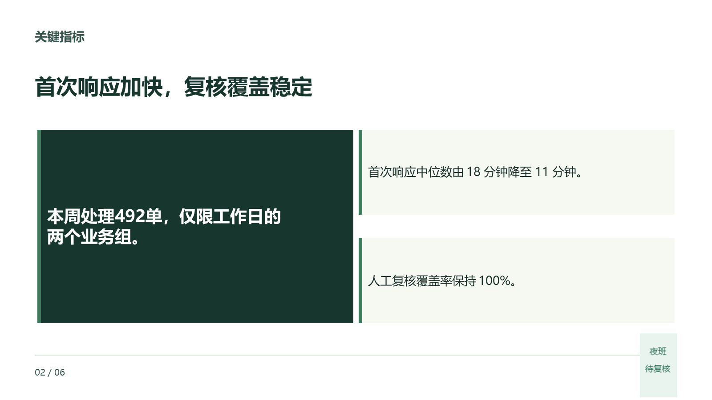</details> |

**必要兼容修复记录：** 单页网格最初会被既有“指标来源失效后停用图表”分支屏蔽，导致已编辑指标页无法采用安全文字设计；已允许该分支使用text/focus网格，保留失效标记且不恢复指标图。P2选项最初截取前三项会遗漏简洁文字，已优先保留安全文字选项，便于取消重点。两项均增加针对性回归。其余首轮测试缺失导入或以未去除显示换行的字符串比较，属于测试修正；没有删除完整性断言。

执行记录：[单元](evidence/p25/unit-final.tap)、[浏览器全量](evidence/p25/browser-final.tap)、[专项复测](evidence/p25/browser-targeted-final.tap)。全量与专项均只使用受路由拦截的mock SDK；模拟的多次明确点击不代表真实平台消耗。确认后的PPTX样例（本地生成物 `release/p25/confirmed.pptx`，不随Git分发）。原生复核入口`scripts/check-redesign-native.ps1`只检查本轮文件。

**仍有限制：** 封面固定排版暂不支持；一次一个候选；自定义网格只允许text/focus，比较/角色/流程使用现有兼容布局。原始叙事layout、正文、metric/metrics及图片均不由模型改写。图片不能挪动或替换，增大文字遮挡的方案会拒绝；过密、阅读顺序错误、未实际采用或视觉相同的方案保持原稿，费用仍按平台实际回执。取消不等于撤销已发出的后端计费请求。当前会话支持一次视觉撤销；持久保存首次AI之前的设计供“恢复原布局”，不提供完整多级设计历史。候选未确认不保存为稿件；真实单页设计尚未验证。

修改文件：bundle/redesign.js（新增）、bundle/layout.js、bundle/app.js、bundle/index.html、bundle/style.css、bundle/diagnostics.js；test/redesign.test.mjs（新增）、test/browser.test.mjs、package.json；scripts/check-redesign-native.ps1（新增）及README/SPEC/产品决策/验收/交付五份现有文档。存储沿用原slide对象的可选redesignOriginal/redesignTrace字段，不改数据库版本；不新增大型编辑器依赖。

## C1–C4 真实响应通用兼容修复（本地候选，未上传）

输入为用户提供的[原始布局诊断](../test/fixtures/customer-platform-diagnostic.json)及PPTX。先只读核对后再修改。新增[正反例测试](../test/compatibility.test.mjs)纳入npm test；未调用Anna，0 CU。原实测回执消耗0.5422413793103448 CU，属于历史调用。

| 问题 | 根因证据 | 是否修改 | 修改理由 | 反例测试结果 |
| --- | --- | --- | --- | --- |
| A completion | values原文是“已处理680单”“收到客户工单800单”，旧numberPattern只接受数值；标签、引用及85%比率本身有来源。 | 是 | 明确整段引用在同一要点中的文字前缀可规范化为数值原子；不改业务数值、不从其他要点取数，不猜关系。 | 非原文引用、118中取18、负数、NaN、约数、零总量均拒绝；编辑后快照失效。不同业务36/40份90%通过。 |
| A 两个comparison | unit为全角％，引用为半角%；values带“当前/阶段目标”前缀；非completion还带rate:null，旧规则拒绝该字段。 | 是 | 仅折叠百分号字形，null等于缺省；保留完整引用证明并增加目标位置校验，禁止把第一个目标当当前值。 | 无关两个百分比、另一指标目标、目标顺序颠倒、跨要点来源、单位不一致均拒绝；正常当前/目标、前后比较及等价百分号写法通过。 |
| B 四步骤加并列检查 | 标题含“按序”而不含旧主题词；旧检测要求每条都匹配步骤。第5条明确“并列核对，不存在先后依赖”，不属于流程节点；空间不是初始根因。 | 是 | 只扩展明确连续步骤＋明确尾随补充，步骤仍须从第一项连续且标记类型一致；补充文字单独完整呈现，不连线。 | 仅标题“四步”、日期列表、编号问题、普通风险、跳步、混合步/阶段、未声明的穿插或尾项全部回退。2/3/5/6步及显式补充正例通过。 |
| C 风险汇总与细项 | 原design给5条相同4×5网格，首条focus不等于显式“汇总—细项”协议；风险页lead本来不参与主证据选择。 | 否 | 不能仅凭含统计数字或首条位置认定汇总关系；新增推断会改变普通风险默认行为。 | 新旧风险页PPTX slide3 XML字节一致；角色页slide4也完全一致。不改角色组件或风险优先级。 |

**结果：** 原33项单元＋新增3项兼容测试通过；3组浏览器针对回放、原多指标组合和P0编号通过。原文全文、1200/480px、独立补充编辑、P2切换撤销、保存重开及PPTX原生对象验证通过。PowerPoint本轮六页72个非空文本框无溢出，文字实际修改及形状移动通过，[原生结果](evidence/compat/native-results.json)。<details><summary>原流程与修复后的独立补充</summary>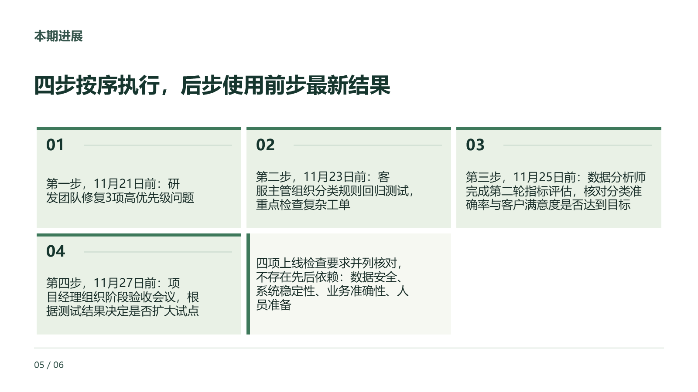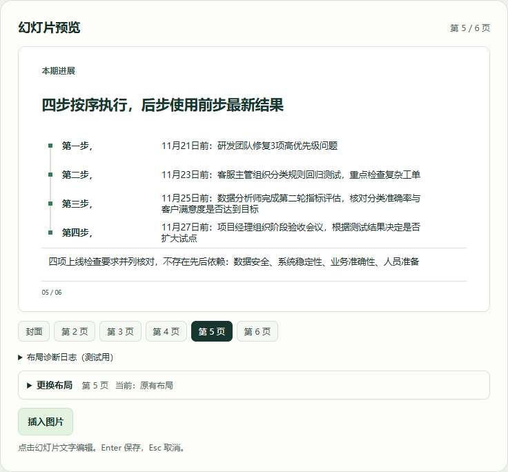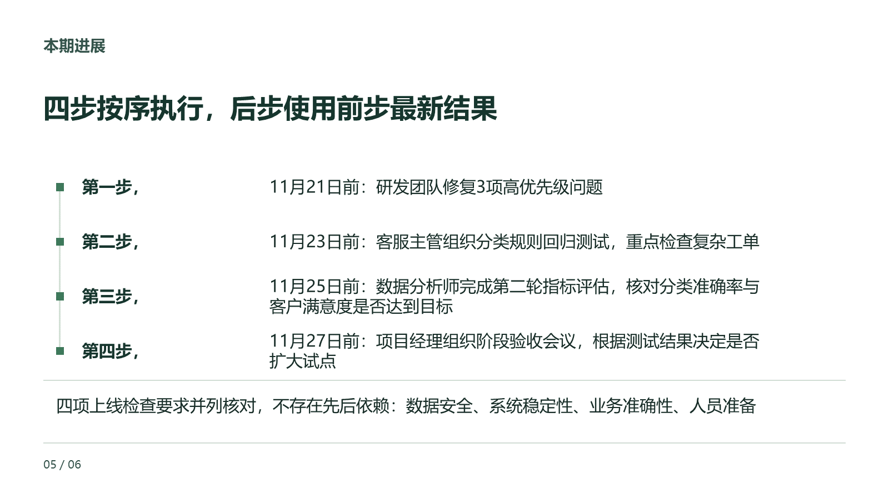</details>

**重要限制：** 本例三个指标修复后均valid，但该页5条内容仍超出现有主指标＋辅助图构图范围，applied继续为false；这是保留的空间回退，未为了样例改布局默认优先级。较长引用、多个数值/范围修饰、目标关系不明确、非同类连续步骤、非明确尾随补充仍安全回退。新增识别范围仅限精确引用规范化和明确混合流程，无法由格式校验证明业务关系真实性；新的严格目标上下文会让含糊写法更保守地回退。

修改文件：bundle/metric.js、bundle/relationships.js、test/compatibility.test.mjs（新增）、test/browser.test.mjs、test/fixtures/customer-platform-diagnostic.json（新增）、package.json，以及SPEC/本验收/交付记录。角色实现、风险布局、P0编号、模型与额度配置未修改。可检查本地回放PPTX（本地生成物 `release/compat/real-replay.pptx`，不随Git分发）。

## V2 最后一轮关系表达与布局诊断（2026-11-20）

**上传更新：** 用户随后给予开发测试版持续上传授权。本轮已上传0.1.13（ID694，rev15），25文件5110.5KB、ready。未调用模型、新增0 CU，未正式发布。下述“不上传”是本地验收阶段的当时状态；真实组件触发与视觉结果仍待用户验证。

**数据与结论边界：** [视觉样例](../test/visual-fixtures.mjs)的知识库指标文案来自用户已给出的真实响应，但组合页与全部metric/metrics标注为模拟重组。跨部门完整输出未提供，问题、角色与步骤文案均明确模拟，不能作为该业务真实验收。未调用Anna，0 CU，未上传staging。

| 用例 | 核对内容 | 验证结果及证据 |
| --- | --- | --- |
| V2.1 角色职责 | 角色和职责对照，不复制或丢失原文；5类正常职责、4–6条长中文；点击职责编辑原完整要点。 | **本地通过。** 原生对象中“角色：”和职责分别呈现，合并读取与原文逐字一致。角色标记编辑为普通文字后退出关系布局，第二条编辑仍绑定正确原点。风险/决策/指标不被自动改为职责页。<details><summary>角色列与职责列</summary>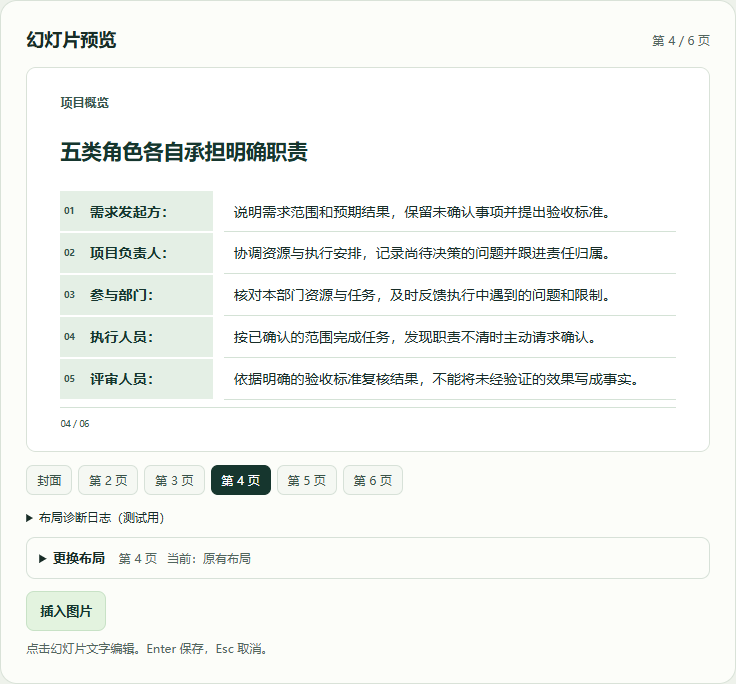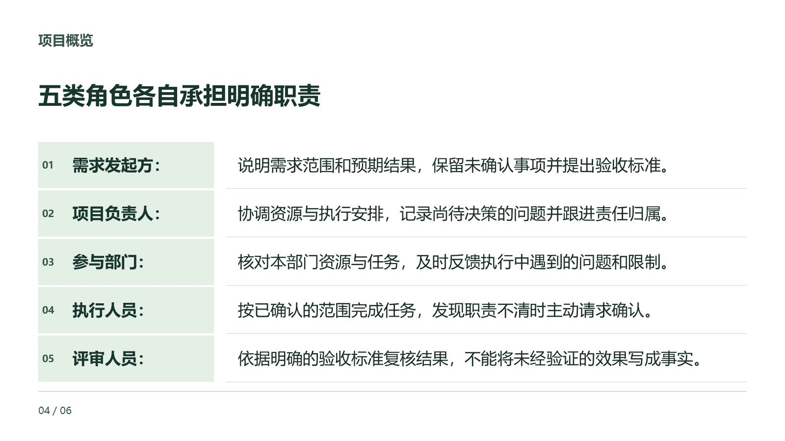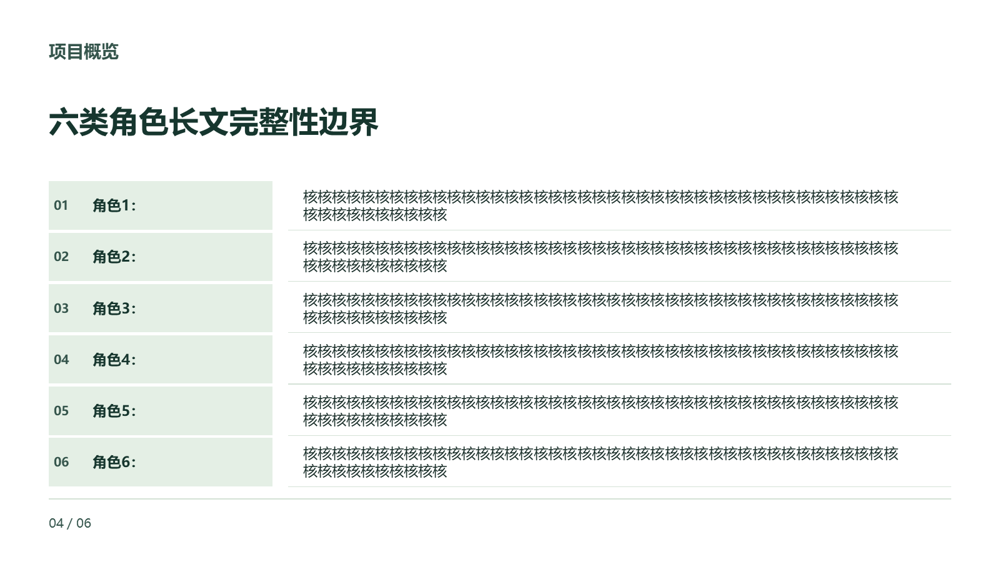</details> |
| V2.2 顺序流程与普通问题 | 明确第一步至第四步采用连接节点，保留顺序及前缀；并列机制、缺步或无序普通问题不画流程。 | **本地通过。** 原文步骤标签唯一保留，不叠加第二套编号；步骤未声明时不生成依赖。普通六项问题仍用清单/分栏。<details><summary>流程与问题清单的区别</summary>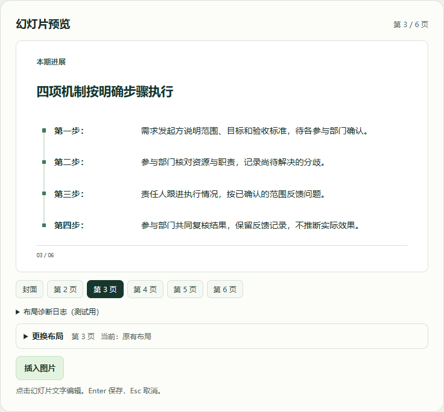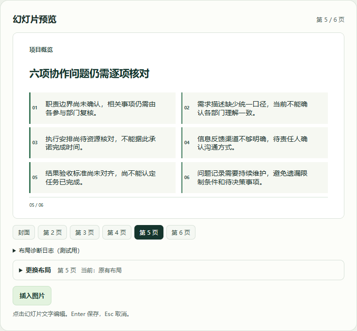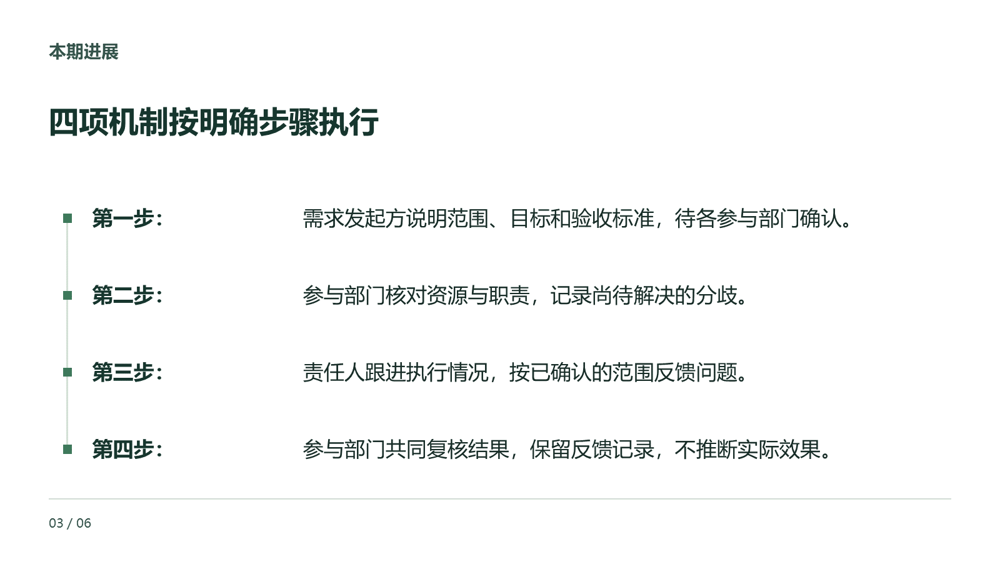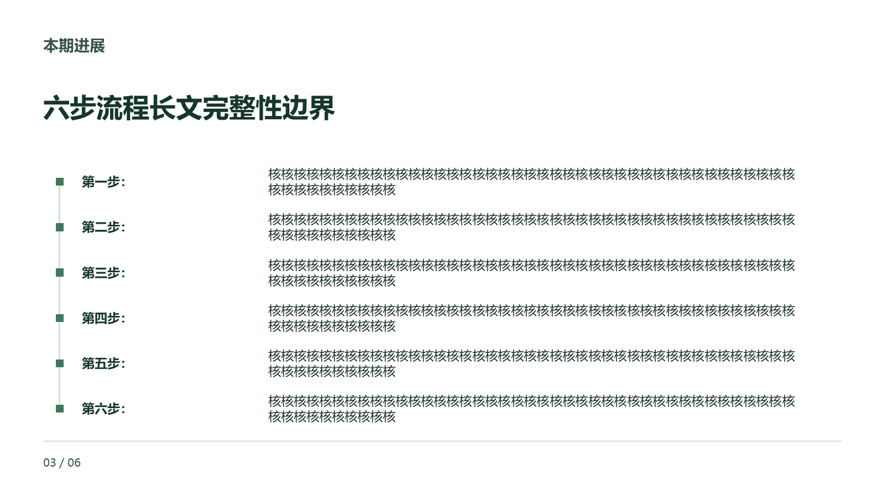</details> |
| V2.3 多指标组合与正确性 | 主4.5→1.8秒比较；辅助108/120条90%完成；辅助86%与90%目标对比；标签/来源/单位/重复索引非法回退，辅助编辑后失效。 | **本地通过，真实协议触发待验证。** 主图保留大数字、统一比例条及约60%变化；辅助图限制在原有辅助正文区域内，不重排主图；全文保留。来源修改后只移除相应辅助项，主指标保留；P2文字布局停用图形，不从文本猜新关系。<details><summary>主次图形与原生导出</summary>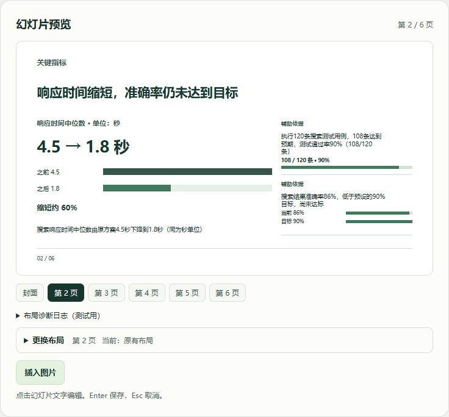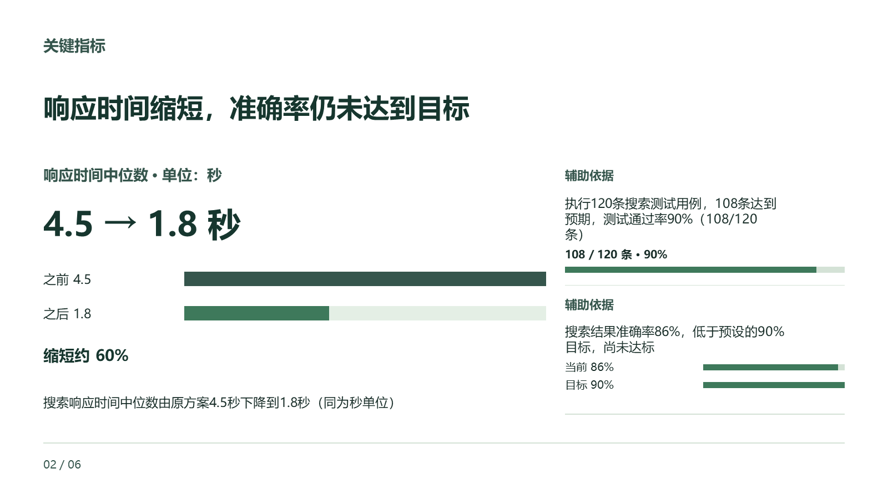</details> |
| V2.4 日志、P2与保存 | 模型原始字段与实际组件分别记录；角色/流程可切列表/分栏，撤销/恢复；辅助来源失效日志；下载日志含原始输出；保存重开仍能检查最初回执。 | **本地通过。** 模拟SDK完成一次生成并持久化回执，刷新后原模型mock-visual、原始输出和失效原因保留；历史无回执时明确不能认定模型已选新组件。下载JSON中originalModelText与模拟原响应完全相同，不含凭据或会话令牌。<details><summary>默认可折叠诊断框</summary>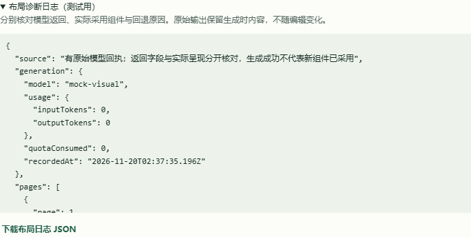</details> |
| V2.5 稳定性与原生编辑 | 33单元、38浏览器；P0编号、长文、无数字、图片、保存恢复及导出；PowerPoint原生编辑和溢出检查。 | **通过。** 两份文件12页147个非空文本框无溢出，所有原始要点在PowerPoint再次逐条核对，文本实际修改、原生形状实际移动成功；测试后不修改源文件。[原生测量](evidence/visual/native-results.json)。浏览器1200/480px及所有文本区域不重叠检查通过。严格Anna打包校验通过。 |

执行记录：[单元](evidence/visual/unit-final.tap)、[浏览器](evidence/visual/browser-final.tap)。正常关系样例PPTX（本地生成物 `release/visual/visual-relations.pptx`，不随Git分发）、长文边界PPTX（本地生成物 `release/visual/visual-long-relations.pptx`，不随Git分发）。原生复核命令为`scripts/check-visual-native.ps1`，只针对这两份文件。首轮全量中旧测试仍假设P2固定六个选项，与上轮P0“不允许后项置顶”已不符；改为枚举所有实际兼容选项、按实际页数遍历，保留全文、宽窄屏和原生导出断言，复测38组全部通过。角色原文拆为两个显示区域、标题原生换行后，旧断言更新为拼接全文核对，不降低完整性要求。旧执行文件保留在release/visual/browser-full-results.tap及release/visual-unit-first.tap。

**下一次真实Anna验收必须同时满足：**

1. 生成成功后展开“布局诊断日志（测试用）”，下载日志与PPTX，保留原始回执及CU。
2. B检查对应页relationship.detected有明确语义、applied为true、实际组件含relation-roles/relation-sequence；这是前端按模型文字语义采用组件，不表示模型返回了一个新布局类型。
3. A检查原始modelReturned.metrics确实存在、每项valid与applied均为true，不能仅因返回了metric或生成成功就判定组合图通过。没返回/校验失败/空间不足时记录具体原因。
4. 目测PPTX主次、角色对应、执行顺序、全部事实及编辑行为。模拟图片好看或日志applied为true本身均不能代替视觉核对。此次真实验收尚未执行。

**仍不支持：** 无明确标记的角色/流程不推测；并列机制不虚构顺序；辅助图限于具有足够空间的指标主证据构图，最多两项，密集4–6条或非指标叙事页可能只保留文字；不从任意数字自动生成图，不支持通用图表、多主指标或自动拆页。

**修改文件清单：**

| 文件 | 修改职责 |
| --- | --- |
| bundle/relationships.js（新增） | 语义证据识别、角色/顺序原生几何 |
| bundle/metric.js、bundle/deck.js | 可选辅助metrics复用来源校验、编辑失效及Prompt |
| bundle/layout.js | 关系布局接入、辅助图及兼容P2选项 |
| bundle/diagnostics.js（新增） | 原始模型字段、实际采用组件与回退原因 |
| bundle/app.js、bundle/index.html、bundle/style.css | 临时日志框、下载及编辑刷新 |
| bundle/library.js | 可选成功生成回执随稿存取 |
| test/visual-fixtures.mjs（新增）、test/deck.test.mjs、test/browser.test.mjs | 明确模拟样例、完整性、编辑/P2/日志/导出回归 |
| test/p2-layout-fixtures.mjs | 边界样例枚举实际兼容选项，避免固定选项数假设 |
| scripts/check-visual-native.ps1（新增） | 本轮PowerPoint原生验证与证据 |
| SPEC.md、README.md、docs/PRODUCT-DECISIONS.md、docs/TEST-CASES.md、docs/DELIVERY.md | 统一规约、产品取舍、证据与待真实验收状态 |

---

## D1 自适应要点布局

### D1.8 重点块编号（2026-11-20，本地修复）

| 验收范围 | 结果与保留证据 |
| --- | --- |
| 知识库上线评审第6页：重点01及后续02–04 | **修复前不通过，用户截图保留；修复后通过。** 编号来自原point索引，重点块预留编号栏，标题不参与编号。正文根据截图转录，其余页面模拟，未声称取得本次完整Anna JSON。<details><summary>修复前后</summary>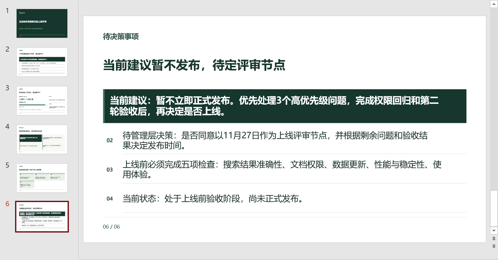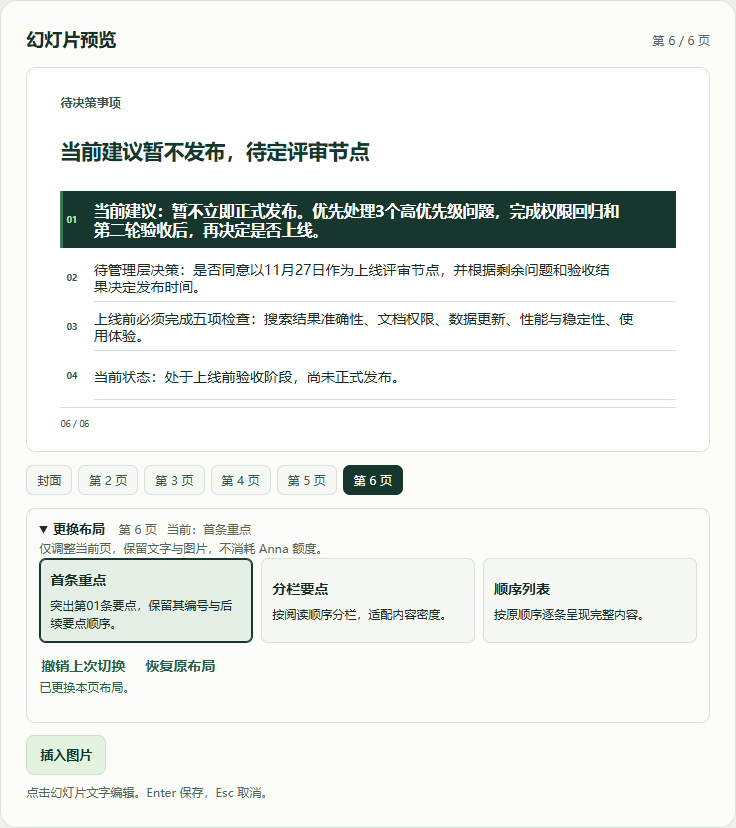</details> |
| 指标、总结、风险、决策；单条、P2取消重点及切换、撤销/恢复、历史存储 | **通过。** 4类语义逐一切换首条重点/分栏/列表，所有要点完整且编号恰一次；单条为01。历史manualLayout兼容，指向后项的置顶重点回退保序布局。保存恢复核对全文与编号；标题、编号均不写入points。 |
| 预览及原生PPTX一致 | **通过。** 浏览器1200/480px核对编号与全文无溢出；逐页导出XML核对01–04各一次，全部原文及原生文字/形状对象保留，无页面截图替代。未重复启动PowerPoint人工检查。 |

本次仅运行2项针对性单元（D1.8、D1.2/D1.5）及1组浏览器回归（覆盖4类语义），均通过；没有运行全量回归、调用Anna或上传staging。当前协议没有独立摘要字段，所以此次重点块按列表成员修复，不额外生成“核心建议”摘要。平台版本保持0.1.12。

**0.1.12 / D1.7：** 用户要求移除文案字数的本地硬门槛，已删除28/56字、单页600及整份6000字符拦截，旧D1.3预算拒绝结论仅保留为历史。知识库真实失败的第2页31字标题及四要点摘录用于回归（其他页明确模拟），另测100字要点，全文进入原生PPTX。2项针对性单元、1组浏览器1200/480px预览及长标题编辑、严格打包校验通过。没有重跑全量浏览器或PowerPoint检查，没有新Anna调用。保留结构和异常响应体积保护；实际空间不足仍明确提示，不删内容。已上传开发测试版0.1.12（ID693，rev14）。

2026-11-20后续D1.6：旧响应将导师与新员工合写，已补Prompt要求一条一个角色，标题与角色数量对应，原始真实响应保留。模拟修正输出的四个独立区域及原生PPTX全文核对通过；本次仅运行D1.1/D1.2/D1.6共3项针对性测试及严格打包校验，均通过，不重复全量浏览器/PowerPoint测试。已上传0.1.11（ID692，rev13），用户自行安装并验证真实Anna行为。新增调用0次、0 CU。以下保留此前本地完整回归。

数据来源：[导师制失败诊断原文](../test/fixtures/mentor-real-diagnostic.json)为用户提供的完整真实响应；1–6条长中文和更多短要点来自明确标注的[模拟边界数据](../test/density-fixtures.mjs)。回放中的0.36 CU是历史回执，不代表新增调用。本轮真实调用0次、消耗0 CU，不上传staging。

最终结果：**27项单元、34组浏览器、Anna本地严格包校验通过**。[浏览器执行记录](evidence/density/08-browser-final.tap)。每个正文布局除容量检查外，还校验完整索引集合，缺少任何要点时回退或明确停止，禁止仅呈现前三条。

| 用例 | 验收要求 | 验证记录（保留失败） |
| --- | --- | --- |
| D1.1 | 原失败JSON成功呈现6页；四阶段逐条保留、顺序正确；异常design回退。 | **修复前不通过。** 完整响应endTurn，输出566/1800 tokens，却因正文固定最多三条拒绝第4页。原始错误及截图保留。**修复后通过。** 解析/浏览器均核对四个原文及索引，几何合法但倒序的模拟design也按原顺序回退。<details><summary>修复前与修复后截图</summary>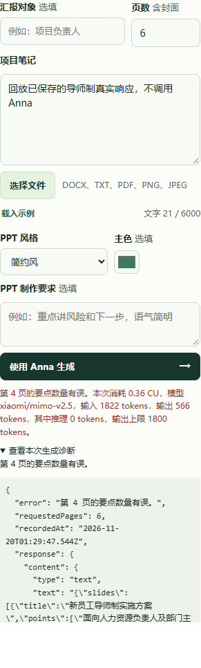</details> |
| D1.2 | 1–6条56字要点、多于六条短要点，预览及PPTX不删、不截、不覆盖。 | **通过。** 单元逐条核对1–6条及7/8/10/12条短要点；浏览器1200/480px验证1–6条长中文及12条短文；所有要点恰有一个编辑区域。原生XML核对全文，存储恢复无删项。不同密度采用分栏、顺序列表及主次布局。<details><summary>长中文密度截图</summary>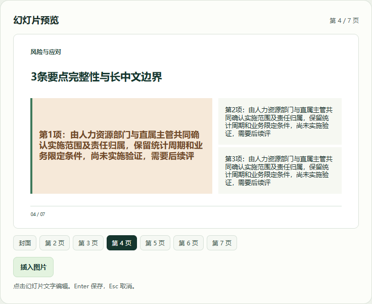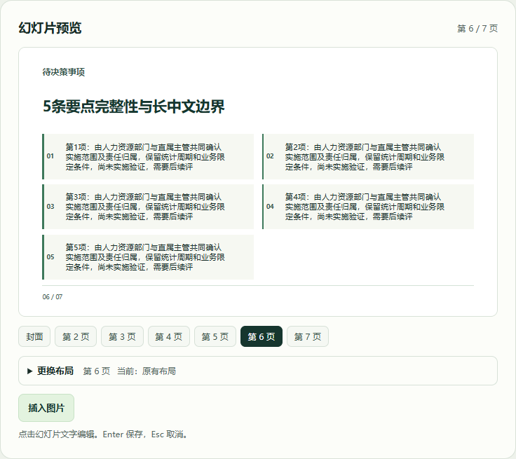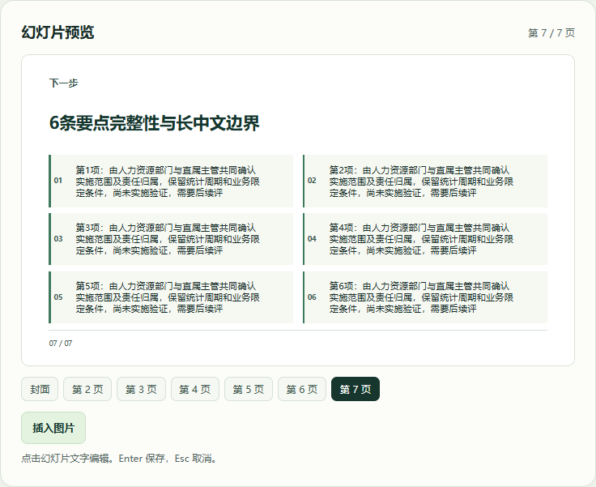</details> |
| D1.3 | 类型、单条长度、单页/整份预算、原始响应体积及排版容量拦截，保留原文。 | **通过。** 空数组/null/空字符串/57字、超单页预算、整份预算及100000字符响应上限分别验证。8条56字超实际可读容量时明确拒绝；8条短文编辑成排不下的长文时输入保留，切页被阻止，旧存稿不变，Esc可取消。未做自动拆页。<details><summary>编辑容量保护</summary>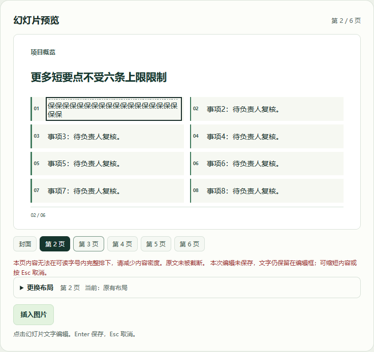</details> |
| D1.4 | 编辑后P2切换/撤销/恢复、保存重开、历史及图片兼容。 | **通过。** 四阶段页编辑第三条后切分栏、列表、撤销和恢复，再保存刷新重开，四条全文和布局均保留。回归既有图片和指标失效测试。组件结构或字段顺序变化时重建DOM，不按旧索引提交。<details><summary>重开后的分栏布局</summary>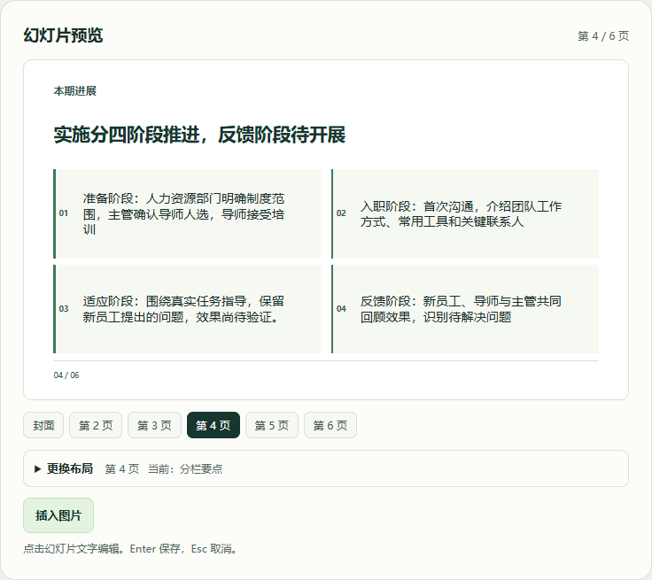</details> |
| D1.5 | 原生PPTX与预览共用布局，文字图形仍可编辑，0新增CU。 | **首次PowerPoint检查不通过。** 导师制第3页一个旧设计文本框宽327.78pt，文字宽336pt；[失败测量](evidence/density/07a-native-first-failed-results.json)保留。改为安全显示换行后**复测通过**：两份导出共13页、100个非空文本框无溢出，实际修改文字和移动形状成功，源文件不被改写。四阶段原文在PowerPoint再次逐条核对。[最终测量](evidence/density/07-native-final-results.json)。<details><summary>PowerPoint检查截图（首次阶段页及最终结果）</summary>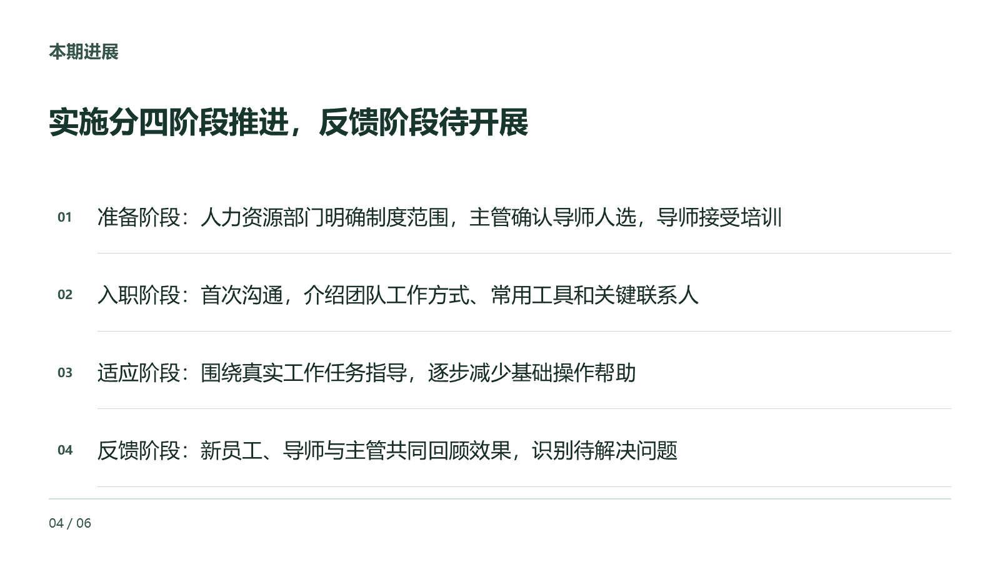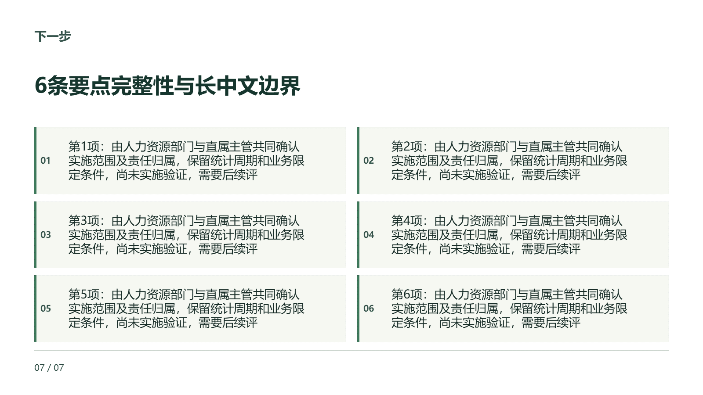</details> |

自动化入口：`npm test`、`npm run test:browser`；本机PowerPoint复核：`scripts/check-density-native.ps1`。可检查导师制回放PPTX（本地生成物 `release/density/mentor-real-replay.pptx`，不随Git分发）与1–6条长文边界PPTX（本地生成物 `release/density/density-boundaries.pptx`，不随Git分发）。容量检测基于保守文字测量，不声称任意数量/任意长文都能排下；放不下时完整保留原始响应，保持用户页数，不自动删内容。

[资料输入](#m1-资料输入与设置) · [逐页设计](#m5-逐页设计) · [历史稿件](#m6-我的-ppt) · [P1.1](#p11-真实生成质量修复) · [P1.2](#p12-指标可视化泛化) · [P2更换布局](#p2-本地更换布局) · [V1数据关系](#v1-主指标与数据关系) · [跨页采用](#v16-跨正文页采用与叙事保护) · [验收输入](#验收输入与操作步骤)

## M1 资料输入与设置

| 规格 | 测试用例与预期 | 执行环境 | 验证 |
| --- | --- | --- | --- |
| M1.1 | 分别提交纯文字、仅 DOCX、仅 TXT、仅 PNG、仅 JPEG 及混合输入。检查文件预读、Word 段落和表格文字、图片缩略图、空汇报对象默认「项目组」，及请求中保留全部有效来源。 | 本地浏览器与模拟 Anna | **当前通过。** 11 月 19 日初测提取和请求通过，联合复核因文件状态冲突判为 **不通过**。修复后同一批输入重新通过回归，界面复测见 M1.4。 |
| M1.2 | 提交空资料、损坏 DOCX、空 TXT、损坏图片、不支持的 CSV、超大文件、第三份同类文件和超长文字。检查错误位置与原因、请求数为零、移除出错文件后其他资料仍在。 | 本地浏览器与模拟 Anna | **通过**。早期版本用 PDF 作为不支持的格式检查，新版改用 CSV。<br> |
| M1.3 | 初次打开默认 6 页。依次输入 4、5、9、12 验证通过。逐键或整段输入小数、负数、字母，检查输入框旁立即提示。空值、3、13 立即提示，改回区间内整数后清除。提交时再次拦截。 | 单元与本地浏览器 | **当前通过。**<br>① 11 月 19 日原用例通过，覆盖点击生成后的拦截。<br><br>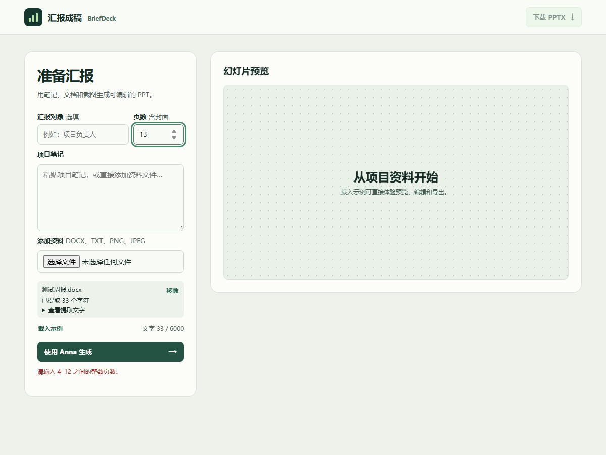<br>② 同日用户发现输入时仍显示小数或负数，框旁无提示，即时校验 **不通过**。新增用例在旧版输入 4.5 立即失败。<br>③ 修复后 **通过**。格式错误当场拒绝并保留原值，空值和越界立即提示，改为 12 后无残留错误。非法值提交没有模型请求。<br><br><br> |
| M1.4 | 键盘打开文件选择并添加 Word。入口可继续选择，列表正确显示已添加状态，无矛盾提示。移除后重新添加同名文件并成功读取。 | 本地浏览器与模拟 Anna | **当前通过，用户已确认。**<br>① 11 月 19 日修复前 **不通过**。用户复现「未选择任何文件」与「已提取」同时出现，Playwright 同样在原生文件框可见的断言处失败。<br><br>② 同日修复后 **通过**。用 Enter 打开文件选择，添加、移除并重新选择同一个 Word，列表正确显示一条已读取记录，入口文案不再出现空状态。<br><br>③ 用户仍在已打开的旧标签页看到原生控件。核对两个本地端口返回的页面均为新版，在新端口复测通过，用户随后确认通过。 |
| M1.5 | 添加 Word 与图片，默认只显示文件数量。用键盘展开、收起；收起时加入错误文件，检查自动展开和错误计数；移除错误文件后，收起列表生成并核对两份资料仍进入请求。移除全部文件后摘要消失。 | 浏览器与模拟 Anna | 11 月 19 日 **自动化通过**。折叠状态提交仍包含 Word 文字和图片。清空后摘要消失。<br>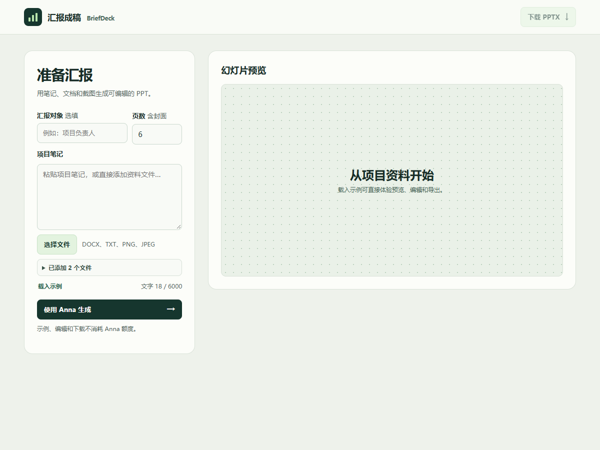<br>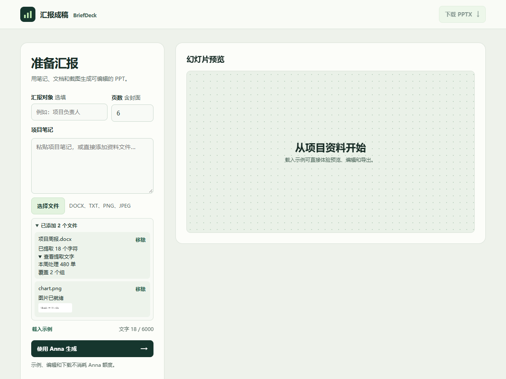<br> |
| M1.6 | 默认简约风和默认主色。切换科技风、自选主色并恢复默认。比较同一份稿件预览和导出，检查内容和版式保留，切换与下载均无模型请求。 | 浏览器、PPTX 文件、PowerPoint | **0.1.3 用户复核不通过，新版本地通过。** 用户选择 `#D7AB79` 后，实测 PPTX 封面仍为 `#142B45`、正文仍为 `#0B1527`，所选色只写入线条和标记。新版测试校验背景和卡片随主色变化。 检查了自选主色写入导出的形状。PowerPoint 实际打开两种风格，保留可编辑指标文字。新版科技风页眉装饰及深色卡片见 M4.4 桌面复测。<br><br>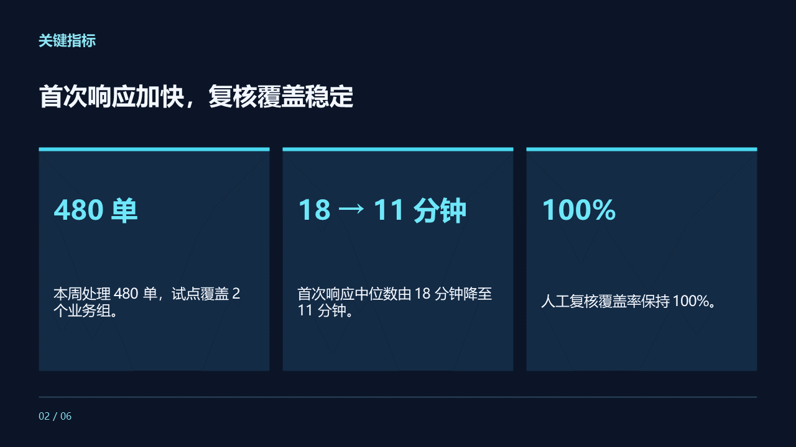 |

## M2–R1 生成到发布

| 规格 | 测试用例与预期 | 执行环境 | 验证 |
| --- | --- | --- | --- |
| M2.1 | 用模拟返回覆盖 4、5、6、9、12 页，验证封面、正文结构与长度。回传错误页数、截断、非法 JSON、额度不足、模型不支持图片和连接失败，检查保留输入和原稿。截断响应包含用量时，检查消耗和实际输出上限可见。 | 单元与浏览器 | **自动化通过。** 模拟截断保留了原稿和附件，显示了模拟消耗 14 CU 及实际输出上限 1500 tokens。此用例消耗 0 Anna 额度。<br> |
| M2.2 | 载入示例、预读附件、切换页、编辑、下载，检查模型调用数为零。模拟连续提交，检查仅一次调用。生成失败后等待，检查请求计数无变化。 | 浏览器与模拟 Anna | 自动化已通过。 |
| M2.3 | 使用 [混合样例](TEST-CASES.md#m23-staging-混合资料)，选择 5 页。核对处理量、截图独有的指标、扩容状态与页数，记录余额前后值。 | Anna staging | **真实生成及文件检查通过，余额差值未记录。**<br>① 11 月 19 日普通下载返回 `App has no published version available`。CLI 创建 `0.1.0` 后补即时校验，并切出 `0.1.1`。<br>② `0.1.1` 一次真实请求返回截断，未获得稿件，用户报告消耗 **14 CU**。<br><br><br>③ 已切出带截断修复的 `0.1.2`，未进行真实复测。<br>④ 已上传含最新编辑功能的 `0.1.3`，用户生成并导出 5 页。核对到 480 单、18→11 分钟、100% 复核和第 3 个业务组待决策。宿主回执为 25.272413793103443 CU、2988 输出 tokens、有效上限 3000，输入和推理用量未知。 |
| M2.4 | 首次生成的汇报中，关键指标、进展、风险和待决策页的标题及版式分别适配内容。核对 480 单、18→11 分钟和 100% 复核覆盖率，检查示例和生成稿使用同样的版式能力。 | 模拟宿主、浏览器、Anna staging | **0.1.3 用户视觉验收不通过，新版本地通过。** 实测复用了示例中的封面、指标、进展、风险和决策构图。新版用一条模拟请求让相同指标和文字显示在纵排中，同时校验默认布局。截图用量为模拟数据。<br> 基线正文重复使用一种版式，用户复核不通过。新版在示例与模拟生成稿中共用不同版式。首次 PowerPoint 测试发现风险页主文本超出文本框 14.5 pt，缩小字号后复测 77 个文本框通过。<br><br>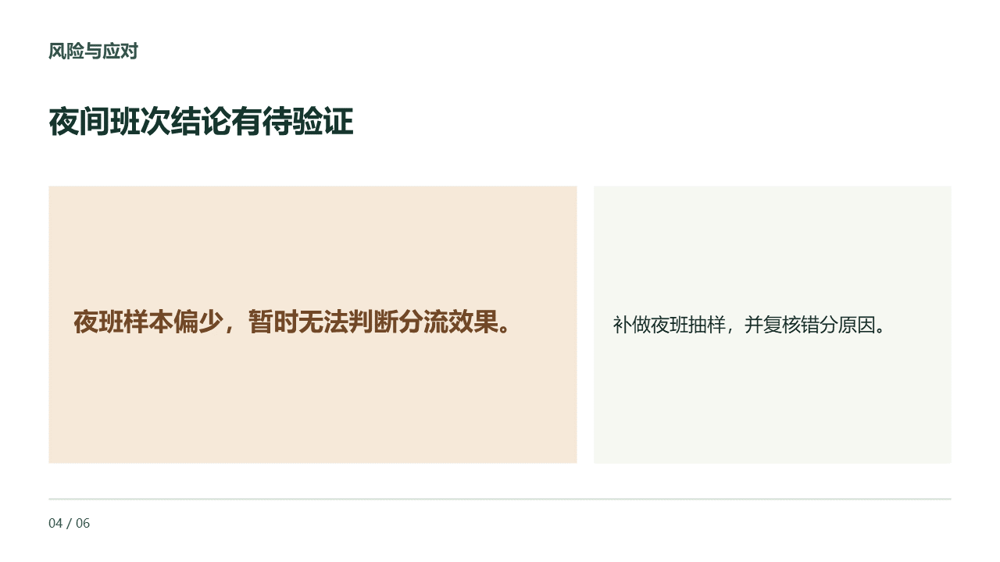<br>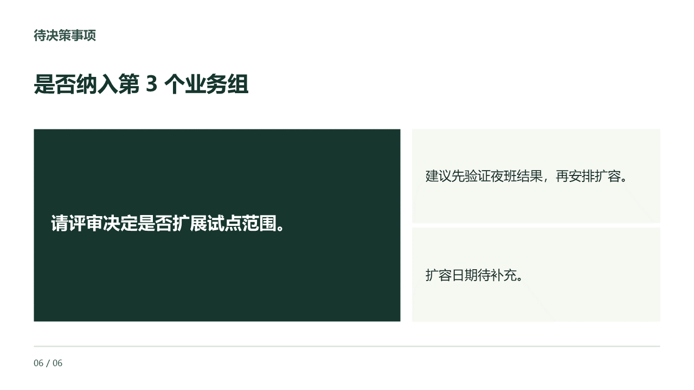 |
| M2.5 | 分别生成科技风和简约风，检查风格对应提示、实际主色、可选制作要求、资料与输出上限。切换风格和主色不发起请求。 | 单元、浏览器与模拟 Anna | **本地请求校验通过，0.1.3 用户用语气偏好真实生成成功。** 文件可见语气词和更活泼的表达。 ① 原版只发送可选制作要求，风格和主色仅作用于本地渲染。对照更新后的生成要求，此项 **不通过**。<br>② 新版每次提交一次。科技风带量化对比指令、自选色及制作要求。简约风带单页聚焦指令、默认色，省略空制作要求。字数仍限制为 300。<br>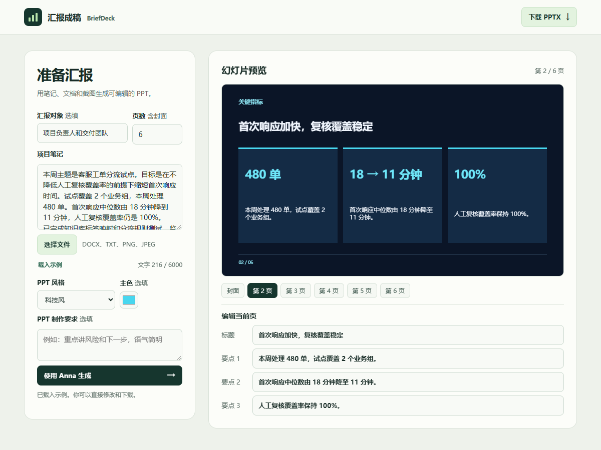 |
| M3.1 | 分别检查 4 页与 12 页稿件的首尾页和页码。编辑末页，切走再切回，检查编辑值和预览一致。修改页数选择时当前稿件页数保持正确。 | 浏览器 | 自动化已通过。 |
| M3.2 | 在已修改稿件时取消生成和载入示例，检查原稿、输入、附件和调用数。检查无稿件时下载禁用。 | 浏览器 | 自动化已通过。 |
| M3.3 | 直接点击画布上的标题和要点进行编辑，用键盘进入编辑、保存与取消。切页后复核保存的修改仍在，取消的内容已还原。 | 浏览器 | **本地通过。** 基线从画布下方编辑，验收不通过。新版使用 Enter 保存、Esc 取消，也支持离开文字框保存。切页保留已经保存的修改，指标跟随要点更新。<br> |
| M3.4 | 批量插入与调整多图，检查正文和指标、换页及换风格。混合有效、损坏、超限图片，保留有效图并提示错误。仅选中图显示右上角红叉，通过红叉或 Delete 删除单图。插入及删除后由画布显示结果。 | 单元与浏览器 | **本地通过。** ① 原用例的单图、替换和异常处理通过。用户复核发现每页只能插入一张、不能调整位置和大小，插图切换正文排版后指标大字可能消失。按更新后的用户验收要求判为 **不通过**。<br><br>② 多图版通过鼠标与键盘调整、错误处理及换页。用户复核发现分批插入仍显示上次批次张数，容易被读成总数，删除提示也持续显示，按新要求判为 **不通过**。<br><br>③ 复测通过。插入和删除无成功提示。仅选中图显示红叉，点击或按 Delete 只删目标图片，重新导出保留其余图片。损坏与超限提示仍可见，全程 0 次模型请求。<br> |
| M4.1 | 解析导出的 4、6、12 页 PPTX，检查页数和修改后的原生文本。用 PowerPoint 打开 staging 导出文件，再编辑并保存。模拟导出失败，检查提示及重试。 | 单元、浏览器、PowerPoint | **本地通过。** PowerPoint 实际打开 4、6、12 页测试文件，分别编辑最后一页文字、另存并重新打开，页数和修改均保留。staging 导出文件待 M2.3 产出。<br> |
| M4.2 | 输入 28 字中文标题和 56 字要点，检查 480 px 与 1200 px 预览，以及 PowerPoint 中的换行和溢出。 | 浏览器、PowerPoint | **通过。** 浏览器两种宽度均已检查。用 PowerPoint 检查三份文件前两页共 30 个文本框边界，未发现溢出。截图文字按字数边界构造。<br><br>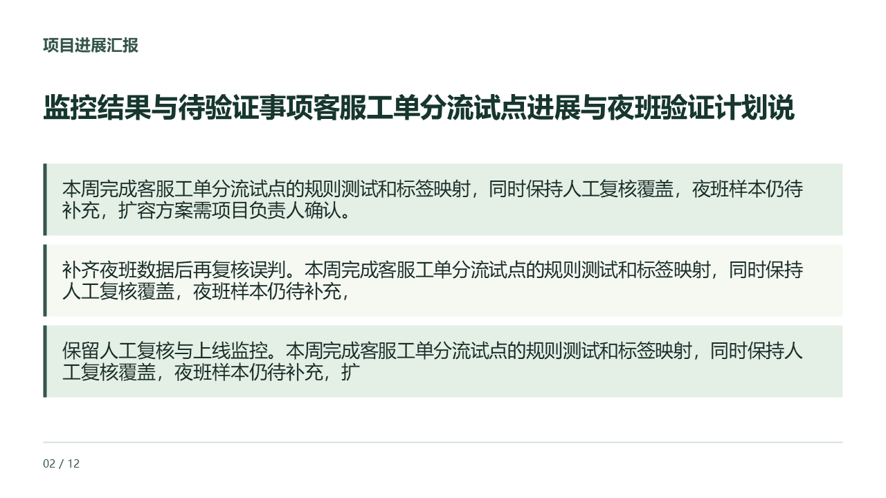 |
| M4.3 | 导出含多种版式的稿件，用 PowerPoint 对照封面、指标和风险或决策页。核对直接在画布上修改的文字进入文件且仍可编辑。 | 浏览器、PowerPoint | **本地通过。** 以示例为起点在画布修改副标题、指标页标题和数字，在 PowerPoint 实际打开浏览器下载的六页文件。标题与测试数字 492 单进入原生文本框，PowerPoint 二次修改后另存并重新打开成功。<br> |
| M4.4 | 下载多图稿，核对图片数量、目标页、坐标和尺寸。验证图片和文字都是独立可编辑对象。移除单张后重新下载。 | 浏览器、PPTX 文件、PowerPoint | **本地通过。** ① 单图基线通过桌面验收。移动图片并另存后再打开，位置保留。<br><br>② 多图版中，导出的图片坐标和尺寸与预览一致，移除一张后剩两张。PowerPoint 打开六页文件，第 2 页有三张原生图片对象和原生指标文本。移动其中一张，另外两张坐标保持不变。<br>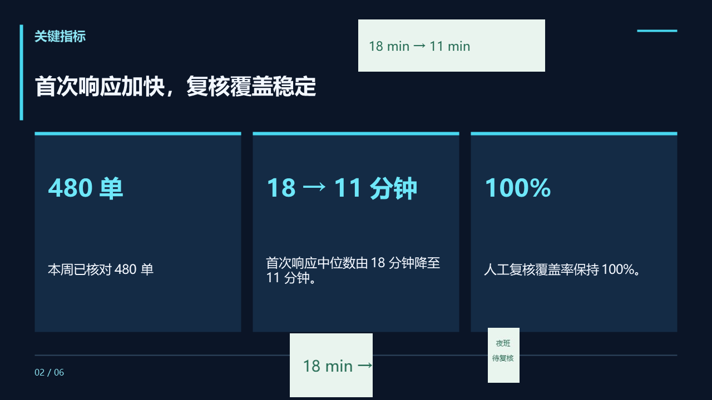 |
| R1 | 校验构建包并上传。审核通过且发布后，从非开发者账号找到、打开 App 并检查使用入口。核对 GitHub 地址、App name 和 slug。 | Anna staging、GitHub | 已通过打包并同步 GitHub。`0.1.5`（ID 686）已提交 Anna 审核，平台返回 `pending_review`。待获批、公开发布和非开发者账号验证。 |

## M5 逐页设计

| 规格 | 测试用例与预期 | 执行环境 | 验证 |
| --- | --- | --- | --- |
| M5.1 | 同一指标文案允许两种坐标。客服试点用前后对比图，分阶段迁移用按日期排列的时间线。 | 单元、浏览器与模拟 Anna | **本地通过。** 实测了同一指标图从左侧移到底部。两份 4 页样例的第 2 页采用不同的原生对象和坐标。真实模型是否能产生适配资料的方案仍待验证。<br><br> |
| M5.2 | 校验越界、重叠、重复引用和未知元素。编辑指标、添加图片及改变窗口宽度，再核对 PPTX。 | 单元、浏览器、PPTX XML 与 PowerPoint | **本地通过。** 非法设计回退为原语义版式，保留有效文案。18→12 分钟同步到对比条标签；导出同时保留独立图片。480 px 下检查了时间线正文。PowerPoint 实际打开两份 4 页文件，核对可编辑文本、原生形状和独立图片。无效稿件保留原稿见 M2.1。<br><br> |
| M5.3 | 用暖金、高饱和色及黑白两端检查两套风格的文字对比度，比较背景与卡片色值。 | 单元、浏览器与 PPTX XML | 首次测试发现科技风自选白色时，卡片 `#73767A` 与正文 `#E8F1FF` 对比度不足，判为 **不通过**。调深卡片后，八个风格与主色组合的文字对比度复测 **通过**。PPTX 背景和装饰色回归通过。 |
| M5.4 | 检查每次点击的请求次数、超时或截断后是否重试、用量字段及编辑导出是否触发调用。 | 浏览器与模拟 Anna | **本地通过。** 两份样例分别发送一次，修改及下载无新增请求。连续点击、截断和用量字段由 M2.1、M2.2 回归覆盖。这次实测消耗 0 CU。 |

## M6 我的 PPT

| 规格 | 测试用例与预期 | 执行环境 | 验证 |
| --- | --- | --- | --- |
| M6.1 | 生成并编辑 4 页和 6 页两稿，设置各自的风格、主色和图片位置。切换及刷新后恢复其中一稿、导出并校验页数和原生图片。 | Chrome、模拟 Anna 存储与 PPTX XML | **本地通过。** 两份稿分别显示名称、页数和当前选择。刷新后 4 页稿恢复主题、主色和图片。切换、新建空白和导出发起 0 次模型请求。<br> |
| M6.2 | 核对箭头居中、统一保存入口、生成后自动保存、手动重存及存储超限。验证浏览器本地恢复。 | Chrome、模拟 Anna 存储、IndexedDB | **本地通过。** ① `0.1.4` 用户截图中箭头偏低，判为不通过。<br><br>② 新版箭头居中。生成后菜单显示已保存，再点击「保存当前 PPT」仍只有同一条记录。存储失败时可下载备份。本地刷新可恢复稿件。<br>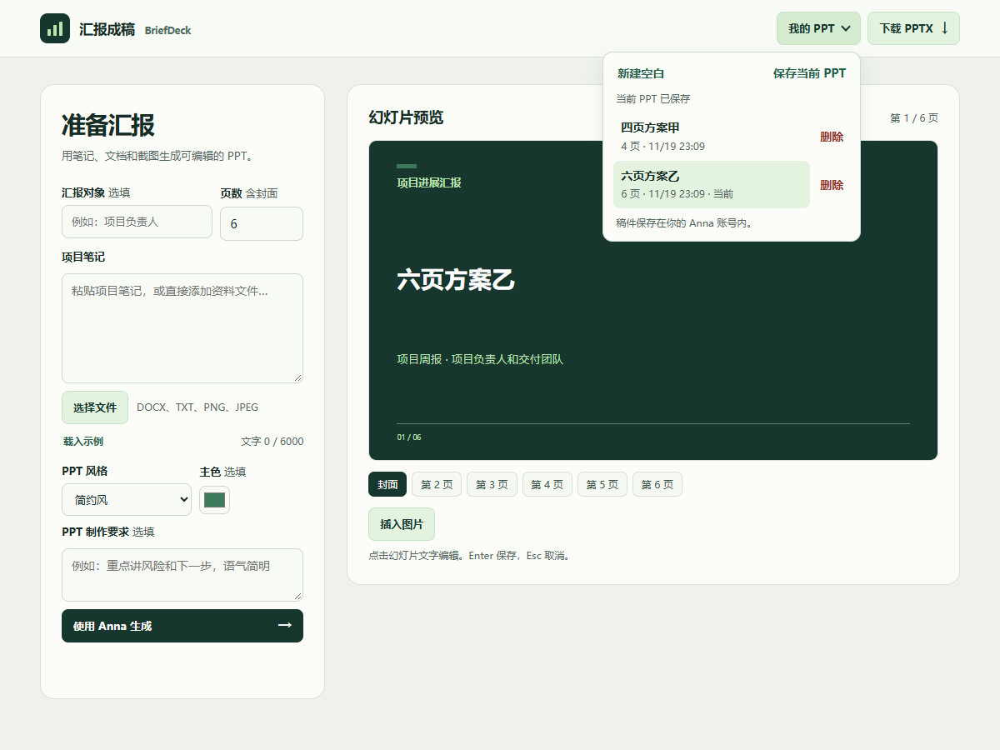 |
| M6.3 | 删除确认、取消与存储失败。已删记录刷新后消失。删除当前稿关闭画布，其他历史保留。 | Chrome、模拟 Anna 存储、IndexedDB | **本地通过。** 取消和失败均保留原稿。确认删除后目标记录从历史移除，刷新只显示其余稿件；浏览器本地存储的删除也通过。0 次新增模型调用。Anna 宿主链路待安装复核。 |

## M8 PDF 资料

| 规格 | 测试用例与预期 | 执行环境 | 验证 |
| --- | --- | --- | --- |
| M8.1 | 上传两页中文 PDF，核对章节、页序、页内行序及数值。分别加入 Word 或 TXT，并附图片。移除 PDF 后其他资料保留。 | Chrome、打包的 PDF.js 与模拟 Anna | **本地通过。** 用原文绘制命令顺序与视觉行顺序不同的中文 PDF 测试。预览和请求中的 PDF 文字一致，混合提交各只触发一次模拟生成，PDF 二进制未进入请求。<br>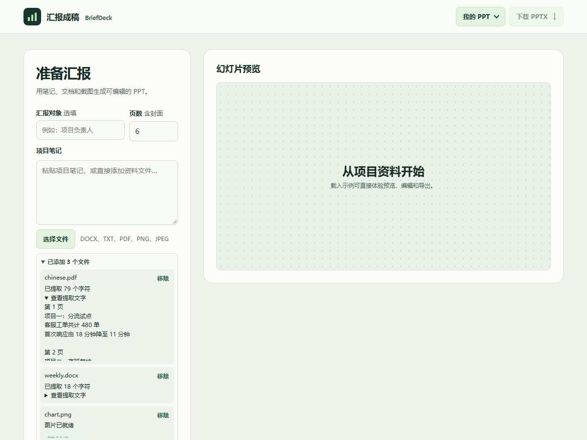 |
| M8.2 | 上传纯扫描件、混合件、加密 PDF、损坏 PDF、超页数、超文件大小和超字数的 PDF。 | Chrome、打包的 PDF.js 与模拟 Anna | **本地通过。** 混合件跳过扫描页，原页序保留；其余异常使用对应提示，未触发模型。移除异常文件后可提交剩余资料。<br>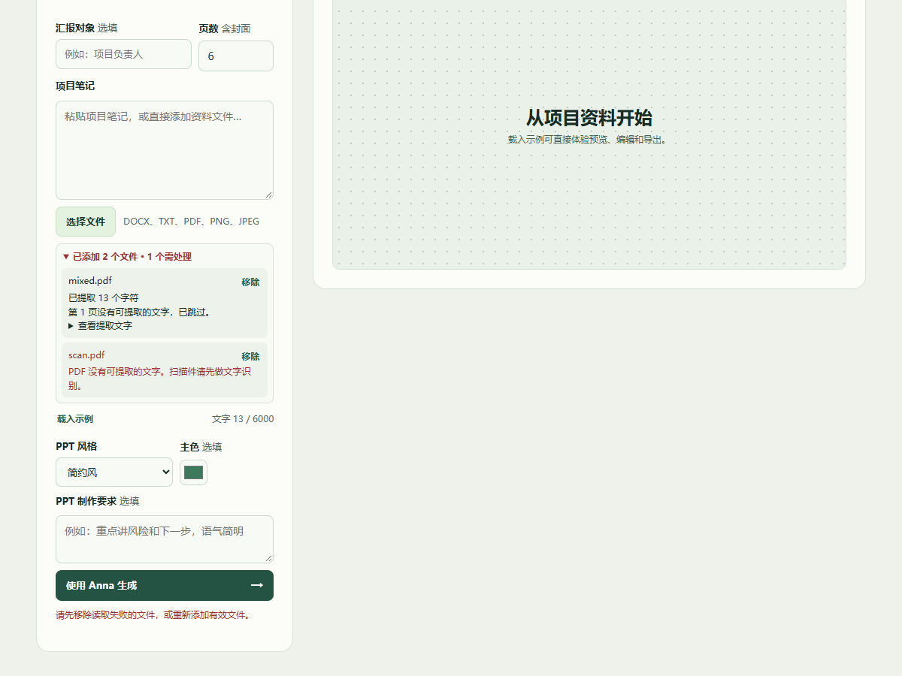 |

## P1 内容质量与专业视觉

| 规格 | 本地结果 | 平台结果 |
| --- | --- | --- |
| P1.1 汇报规划 | 单次请求保留原预算，包含负责人和执行团队的组织重点，无中间规划回复。模拟数据沿用既有迁移时间线。 | `0.1.6` 两次实测，第一次封面结构失败，第二次生成六页。旧版出现未经证实因果，P1.1 已补约束，待日后观察 |
| P1.2 主证据 | 同一组数据把主点从第 2 条换到第 3 条后，字号及正文面积随选择移动。缺失、非法索引及非指标页维持原布局。<br>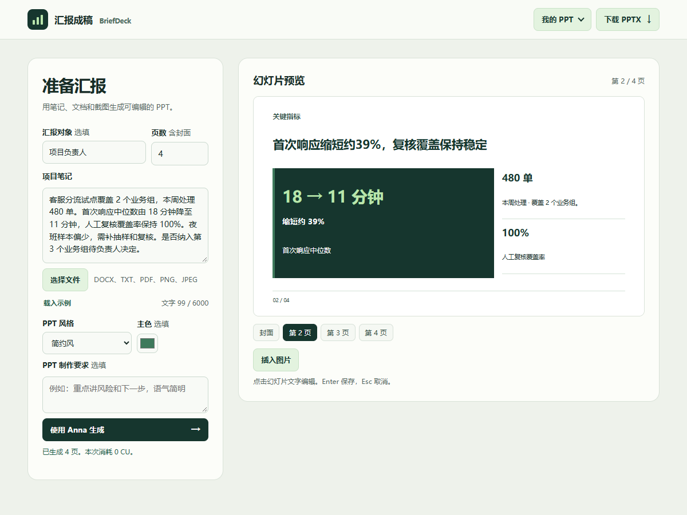 | `0.1.6` 真实 focus 未形成大数字，不通过。修复回放见下节 |
| P1.3 去重与编辑 | 保留业务范围和工作日限定。编辑器读取原始要点，修改为 18→12 分钟后差值同步，零基线无相对百分比。 | 真实模型将多个指标写入同一条。回放保留完整原文，拆分边界见下节 |
| P1.4 视觉与导出 | 480 和 1200 px 通过。PowerPoint 打开模拟导出，指标页 10 个原生文本框未溢出，主证据可以继续编辑。 | `0.1.6` 文件已取得，P1.1 完成六页回放桌面检查，见下节 |

## P1.1 真实生成质量修复

回归来源为用户在 `0.1.6` 获得的成功响应，含原文和真实用量，见 [固定样本](../test/fixtures/p1-real-response.json)。本地回放中的 0.29 CU 提示来自该历史回执，本次回放未调用 Anna。第一次失败响应未取得，封面错误使用人工构造的多副标题样例验证，不能据此断定首次偏差。

| 规格 | 验收条件 | 历次结果与证据 |
| --- | --- | --- |
| P1R.1 指标主视觉 | 原响应不含 lead，唯一 focus 指向第 1 条。新渲染突出数值和变化率，其余复合指标完整保留。已有 compare、milestone 及无明确主证据时保留既有布局。 | ① 原稿不通过，两个文本块没有数值层级。<br>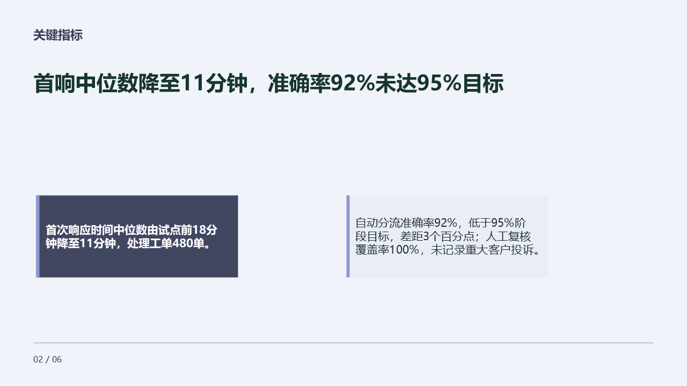<br>② 本地回放通过，主视觉为 18→11 分钟、缩短约39%。原始两条要点仍完整保存在数据中。<br>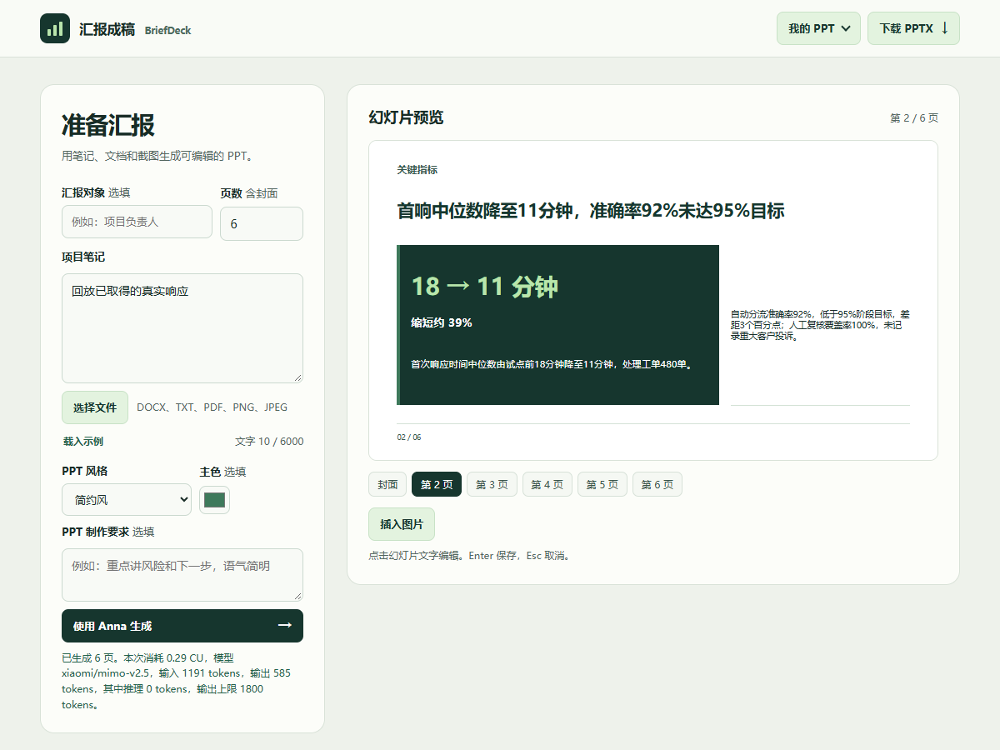 |
| P1R.2 决策层级 | 当前建议独立于条件，字号和面积更大。编辑器保留原句，历史稿可以识别唯一的明确建议标签。 | ① 原稿不通过，两块近似等权重。<br>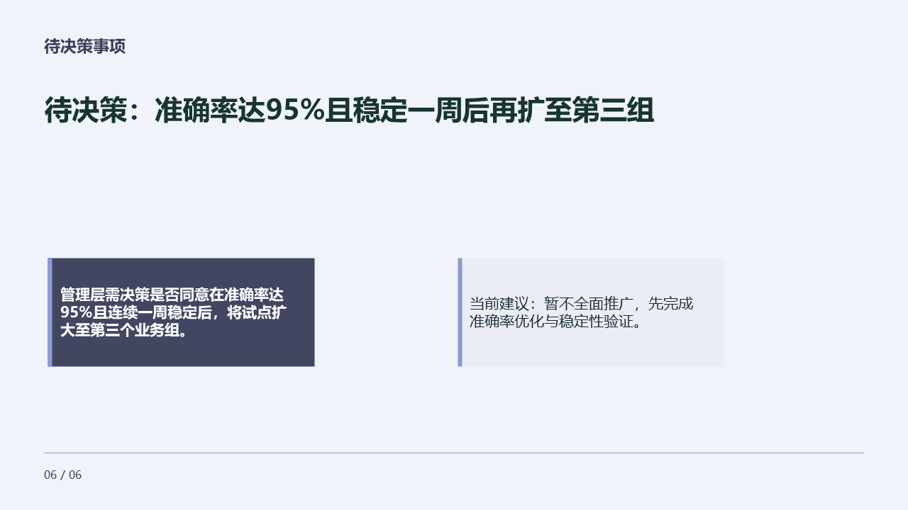<br>② 本地回放通过，建议突出，95%且连续一周的条件保留。<br>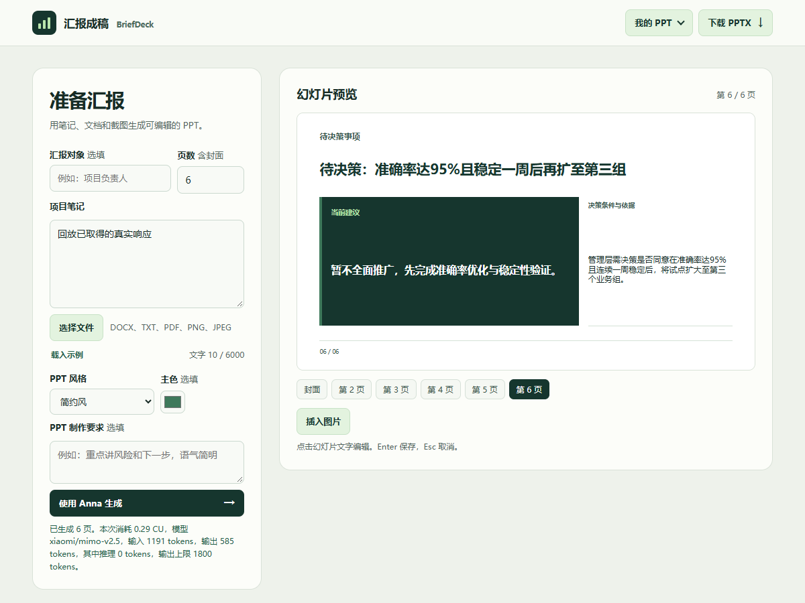 |
| P1R.3 契约与诊断 | 封面一个字符串数组，正文 1–3 个字符串，空、缺失、多条或错误类型仍拒绝。提示词含因果约束。失败可查看及下载完整输出、错误和用量。 | 本地通过。人工构造的封面错误能复现；下载 JSON 与模拟失败响应一致，旧稿和修改仍在，无自动重试。旧成功响应中的未经证实因果句保持原文，供追溯。<br>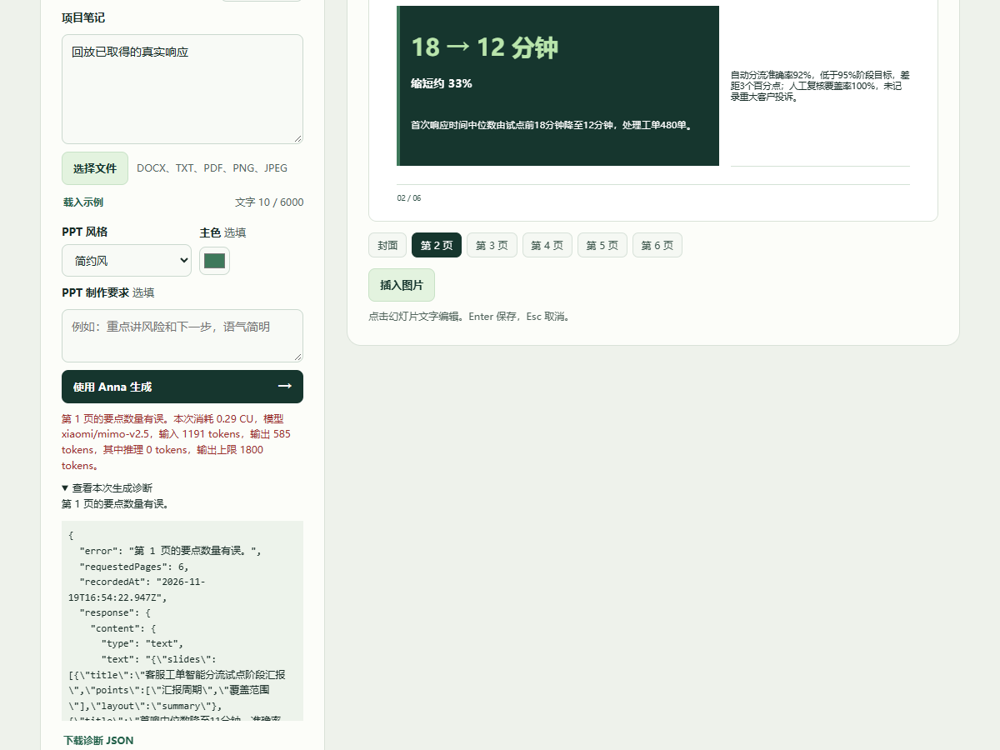 |
| P1R.4 导出与兼容 | 原生文本、形状可编辑，两种窗口宽度内无溢出，原对比与时间线、图片、保存和删除回归通过。 | 浏览器通过。PowerPoint 首测两处文字宽度超出约15–20 pt，记为不通过。<br>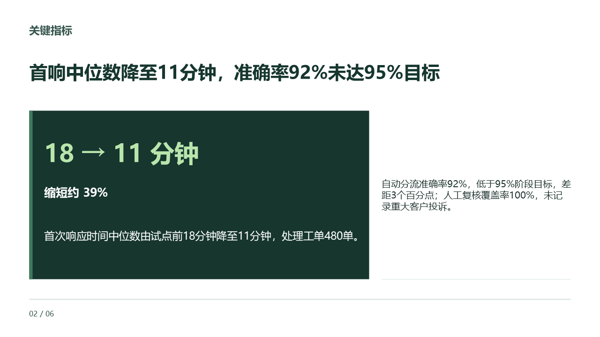<br>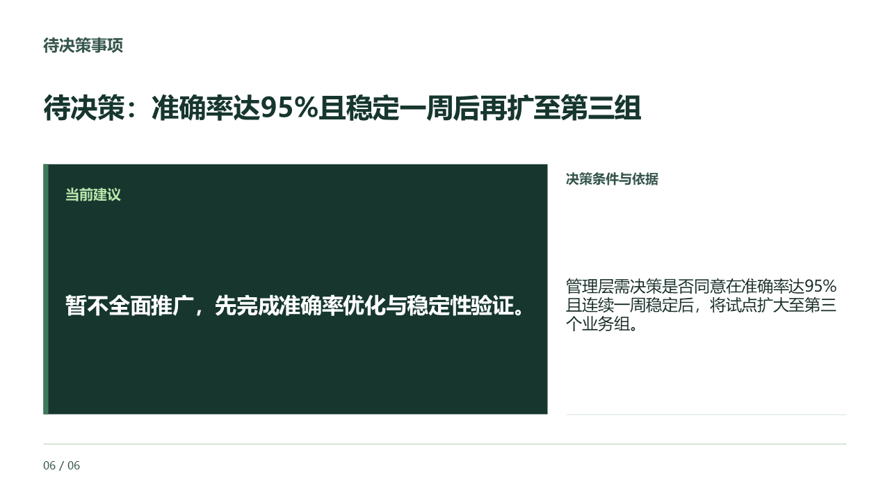<br>说明字号17→16 pt、建议23→22 pt后复测六页共37个原生文本框通过，主指标直接编辑成功。<br><br>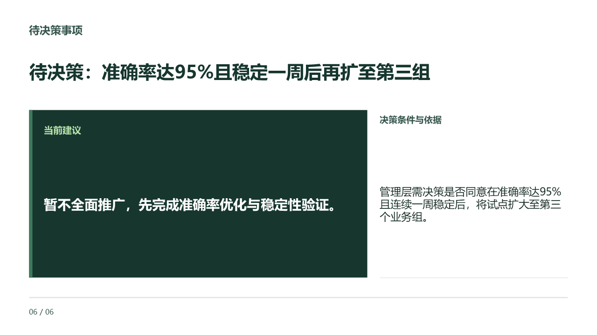 |

## P1.2 指标可视化泛化

来源：客服使用完整真实响应；迁移使用用户确认、且与 E 盘原生 PPTX 核对一致的第二页内容，见 test/fixtures/p12-migration-excerpt.json。迁移原始 JSON 未保存，lead/design 未知；所有新增参数均为模拟。不得将本次回归说成两份完整真实 JSON 回放。

| 规格 | 用例与预期 | 验证记录 |
| --- | --- | --- |
| P1G.1 | 单值80%、明确8→2及缩短到句式、客服18→11；零基线和方向矛盾不计算；多组比较不猜重点。 | 单元通过，客服仍为约39%，迁移为约75%。没有主证据时沿用已有布局。 |
| P1G.2 | 迁移在模拟lead与唯一focus下突出比较，其余量、目标及口径保留。 | ① 0.1.7真实导出视觉不通过，只有复合大段文字。<br>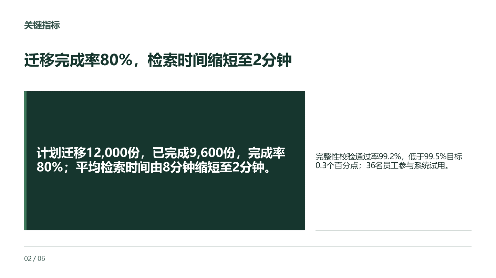<br>② 修复后模拟参数回归通过，保留12,000/9,600、80%、99.2%/99.5%、0.3个百分点及36人。<br> |
| P1G.3 | Prompt主指标单独成点，完成量/总量及限定不丢失，单次请求上限1800。 | 请求契约通过；本轮未调用Anna，实际模型对新提示的遵循未验证。 |
| P1G.4 | 快照恢复、编辑、窄屏、原生导出、历史和无效参数回退。 | 15项单元、20组浏览器及Anna严格包校验通过。1200/480px无文字越界，编辑到8→4同步50%，保存和删除等既有用例通过。PowerPoint实际打开六页37个文本框，无宽高溢出，主数字原生文本可独立修改。<br> |

限制：本轮不新增通用结构化指标协议；完成/总量仍以文字保留，没有自动环形图或进度条。不能确认原迁移响应是否选了lead/focus。历史数据机制已保留这些字段，但尚未读取用户账户的实际记录。回归导出为 release/p12-migration-simulated.pptx，除第二页外沿用示例页，不能视为完整真实迁移稿。


## P2 本地更换布局

范围对应 [P2 规约](../SPEC.md#p2-本地更换布局)。客服指标文案来自已保存真实响应；总结页和56字边界为明确的模拟数据。历史通过本地模拟Anna存储和独立浏览器IndexedDB分别验证，本轮未调用真实Anna。

| 规格 | 用例与预期 | 执行结果与证据 |
| --- | --- | --- |
| P2.1 兼容与隔离 | 指标页按主证据提供2–3个选项，总结页提供突出首条、并列、简洁文字。封面及其他页型不显示入口。连续切换只改当前页manualLayout，原文、设计和其他页均保留。 | **通过。** 覆盖无lead的示例指标页、真实文案及模拟总结页。三种指标呈现分别见下图。<details><summary>指标页布局</summary><br><br></details><details><summary>总结页布局</summary><br><br></details> |
| P2.2 编辑与恢复 | 修改后切换，包括textarea尚未离焦；撤销/恢复只回滚布局，跨页有独立撤销记录。切换失败保留原布局并提示。 | **通过。** 工作日与业务范围限定、492单和未提交编辑保留。撤销与恢复原布局不改文字。注入本地校验失败，已有布局和原文完全一致；解除模拟故障后可继续切换。 |
| P2.3 持久化与图片 | 保存后刷新打开；模型宿主存储及浏览器IndexedDB均恢复。图片位置不随布局变，切换后仍可移动。旧稿和未知manualLayout可打开。 | **通过。** 带图稿件在保存、重开后仍为简洁文字，位置一致；无效override回到原有主证据布局。已有design、lead、composition均保留。 |
| P2.4 预览、导出和额度 | 1200/480px、6种手动布局、每条56字，原生PPTX与预览共用排版；文字、形状和图片独立可编辑，0次新增模型请求。 | **正常内容通过；长文曾失败，修复后通过。** 首次原生检查4处宽度超出约10–21pt，判为不通过。只缩字号的第一次修复仍有6处超出约2–14pt，继续判为不通过。最终长文使用共享的显示换行及小幅字号调整，原始文字不变，数字/百分比保持连续；原生边界复测通过。失败和复测截图保留如下。<details><summary>首次边界失败</summary><br><br><br></details><details><summary>第一次修复仍未全面通过</summary><br><br><br></details><details><summary>最终六种布局边界通过</summary><br><br><br><br><br></details><details><summary>浏览器实际下载文件的原生检查</summary><br></details> |

自动化过程：首次完整浏览器回归21/22通过，剩余一项为模拟历史记录标题与封面标题不一致；保存时标题按封面更新，导致测试查找旧名称超时。统一夹具名称后P2专项通过。这是测试数据问题，未作为应用缺陷修复，失败记录在此保留。

已通过17项单元、24组浏览器回归；本地生成请求计数覆盖切换、撤销、保存、恢复和下载，均无新增请求。原生桌面验收覆盖两份6页正常稿及一份7页六种布局边界稿，共120个文本框最终无宽高溢出；实际修改并恢复主数字/正文及独立图片成功。所有截图在本节验证栏可直接查看。

已知限制：仅支持指标页和总结页；重点指标要求原页面已有可靠主证据。撤销历史仅存在于当前打开会话；恢复原布局可在重开后使用。图片沿用原位置，不自动避让正文。未新增真实Anna调用或重新生成整份PPT。


## V1 主指标与数据关系

对应[SPEC V1](../SPEC.md#v1-主指标与数据关系)。以下为本地候选验收，完成时未上传或发布。随后用户授权上传开发测试版，版本与状态见DELIVERY；真实Anna生成仍待用户实测。本地验收真实Anna调用0次，新增0 CU。

数据来源：客服文案沿用已保存真实响应；迁移文案沿用用户确认且已与PPTX核对的摘录。所有新metric字段均为测试中显式补充的模拟标注，不能视为Anna已经成功返回新协议。边界例和长文例为合成测试数据。原始正文未被替换为“理想答案”。

| 规格 | 验收条件 | 结果与截图 |
| --- | --- | --- |
| V1.1 可选协议及来源 | 三种kind，保持points；片段引用、标签、单位、数量、有限值和快照核对。缺失或非法字段回退，原设计与旧稿保留。 | **通过。** 负数、不同单位、非数值、部分数字引用、重复使用同一来源、错误rate与过期快照均覆盖。rate按原文精度舍入核对，包含12.35%→12.4%的边界。原有P1/P2回归保留。<details><summary>不同单位的安全回退</summary><br></details> |
| V1.2 前后比较 | 18→11、8→2，同一尺度，单位及辅助证据保留；零基线不算相对变化，零值不伪造可见条长。 | **通过。** 对比条宽度比与数值比一致；分别显示约39%、75%；基线0展示明确说明，不输出NaN/Infinity。<details><summary>浏览器比较与零基线</summary><br><br></details><details><summary>原生比较导出</summary><br><br></details> |
| V1.3 完成进度 | 9,600/12,000份对应80%；零总量回退，超额保留真实完成率，轨道最多填满；单一百分比不自动变成进度。 | **通过。** 15/12份显示125%、超出3份。错误完成率即使出现在来源中也不绘图。single的80%仅显示大数字，不绘进度。<details><summary>完成关系与边界</summary><br><br></details><details><summary>原生进度导出</summary><br><br></details> |
| V1.4 编辑、P2与存储 | 取消或无关编辑不失效；来源变动后删除metric并持久标记失效，安全文字显示，撤销不能复活旧数据。组件数变化重建，点击下一要点仍能进入正确编辑框，图片保留且可移动。 | **通过。** 9,600改为9,000后旧80%组件与剩余2,400均消失，显示明确提示；标题/辅助要点编辑不影响有效图。相关编辑保存后刷新重开保持失效。有效图支持关系/并列/简洁切换及撤销、恢复，points和源快照保持一致。<details><summary>失效后的预览与原生导出</summary><br></details> |
| V1.5 宽窄屏与可编辑导出 | 1200/480px；56字主点及两条56字辅证；预览与PPTX共用几何；原生文字和矩形可独立编辑。 | **通过。** 22项单元、28组浏览器、Anna严格打包校验通过。9份浏览器实际下载文件共52页、344个文本框无宽高溢出；前8份已实际修改并恢复文本与形状位置，第9份专项检查长文边界；另逐一修改并恢复客服/检索/完成三份文件的主数值和实际填充矩形，全部成功。数字、单位、原文、比例通过布局/PPTX XML与浏览器核对；无整页图片化。<details><summary>长文边界</summary><br><br><br></details> |

边界与剩余验证：数值引用只能证明组件与页面原文一致，不能自动证明原文业务事实或关系声明正确。上一轮仅metrics页启用，已由V1.6取消硬限制；旧稿仍不自动生成metric。相关要点修改后停止图形，不自动同步数值；原有标题和其他页不被改写，因此提示用户核对相关文案。在PowerPoint中原生文字/形状可独立编辑，但手动修改导出后的数字不会联动计算条长。真实Anna遵循新字段、角色关系与1800 token预算的稳定性尚未测试，需用户确认后另行安排一次受控生成。


## V1.6 跨正文页采用与叙事保护

定位到限制在四层：Prompt仅允许metrics、parseDeck按页型过滤、resolveMetric拒绝非metrics且要求与lead重合、P2只列指标/总结。现已允许任意正文提供可选metric，先做原有来源/单位/关系校验，再按现有文本区域空间决定采用。没有合适数据或空间时保留原布局，不强行补指标。

目标对比增加可选basis:"target"，values按[当前,目标]，来源必须明确有“目标”；旧comparison默认前后关系保持不变。非指标主视觉只在来源区域附加小图，原有其他文字字号、坐标、底色及design保持。必要的显示换行不改原文或字号。来源修改仍停用指标，非指标页保留原叙事，不能通过撤销复活旧图。

| 规格/场景 | 验收条件 | 结果与证据 |
| --- | --- | --- |
| V1.6 指标页 | 18→11分钟、约39%，保持原主指标能力。 | **通过。** <details><summary>指标页预览与原生导出</summary><br></details> |
| V1.6 进展页 | 9,600/12,000份、80%，保留完整性校验99.2%/99.5%与36名试用者，原章节不被改为指标页。 | **通过；保留桌面失败记录。** 首次原生检查发现未改动的辅证段落有约9.6pt标点悬挂越界，记为不通过；第一次仅按长文阈值换行未覆盖43字段落，复测仍不通过。改为按实际区域宽度控制显示换行，保持原字号、坐标和原文后通过。<details><summary>失败及最终复测</summary><br><br><br></details> |
| V1.7 风险目标 | 当前92%与目标95%，差3个百分点；保留“暂不全面推广”的主要风险结论及字号位置，不能显示时间改善。 | **通过。** <details><summary>风险页原叙事优先</summary><br></details> |
| V1.6 总结与决策 | 总结可在兼容卡片中呈现100%核心数值；决策lead与metric.point可不同，效果比较不能覆盖当前建议。 | **通过。** 决策以已有18→11分钟事实构造辅证例，未把时间数据改成成本事实。<details><summary>总结/决策兼容组件</summary><br><br><br></details> |
| V1.6 无数字/不适合 | 无数字正文不生成图；已有milestone里的阶段序号即使有数字也不替换为指标对比；狭小设计区合法metric仍保留但不采用。 | **通过。** <details><summary>不强行可视化</summary><br><br><br></details> |
| V1.6–V1.7 P2/编辑/导出 | 仅兼容页面提供辅助图与原有叙事两项，切换撤销恢复不改原文；来源编辑后停用图但保留主风险；宽窄预览和原生文件一致。 | **通过。** 24项单元、30组浏览器、Anna严格校验通过。7份实际下载的6页文件共42页262个文本框最终无宽高溢出，原生文字及矩形可编辑。本轮真实模型调用0次、CU为0，未上传/发布。 |

测试过程记录：新单元首轮23/24通过，先后修正三类测试假设：既有决策组件把“当前建议”作为独立标题；单值并不必然有条形；显示换行允许变化但字号、几何和原文必须一致。没有以放宽来源、数值或关系校验通过测试。最终断言同时检查原始points、叙事样式、目标标签、条长比例及原生导出。

剩余范围：不主动重排整页给图表腾位置；过窄/过矮区域、超长轴标签、来源块已有compare或milestone时不附加新组件。其他旧P2布局能力不因新字段缺失而改变。新字段仍是本地模拟标注，真实Anna遵循basis及跨页选择尚未验证。


## 验收输入与操作步骤

以下保留各轮固定输入和原操作步骤。历史版本号用于追溯；复测请使用交付记录中的候选版本。真实生成需另行安排，本地模拟与示例操作不消耗额度。

## P1 staging 单次实测

选择 **5 页、汇报对象「项目负责人」**。用文字样例，无需上传文件。记录调用前余额，只点击一次「使用 Anna 生成」。失败时记录原始用量提示，不立即重试。

```text
客服分流试点本周处理 480 单，覆盖 2 个业务组。首次响应时间中位数由试点前的 18 分钟降至本周的 11 分钟，人工复核覆盖率仍为 100%。
知识库标签映射和规则测试已完成，监控页已能按业务组查看响应时间。夜班样本偏少，暂时无法判断分流效果，下一步补做夜班抽样并复核错分原因。
是否把试点扩展到第 3 个业务组，待负责人决定。建议先核对夜班结果，再安排扩围。扩围日期未定。
```

检查标题连读能否看出结果、限制、行动和待决策事项。首页后的核心指标是否优先展示响应变化而非最大的绝对数字。核对处理量、复核覆盖率、夜班限制和待决策状态。记录宿主返回的 CU、模型、输入、输出、推理及上限字段，下载 PPTX 并检查原生文字和形状。单次实测只观察负责人场景，执行团队差异由本地请求契约检查。

## M2.3 staging 混合资料

运行 `node scripts/staging-fixture.mjs` 准备两份合成测试资料，输出在 `release/staging-fixture/`。Word 的处理量为 480 单，监控图的首次响应中位数为 18 分钟降至 11 分钟。两项数字来自不同文件。

1. 在 [staging 开发者控制台](https://staging.anna.partners/developer) 的「我的应用」安装或升级 BriefDeck 开发者测试版 `0.1.3`。填写汇报对象「项目负责人和交付团队」，页数选 **5**，选择科技风与一个自选主色，制作要求填写「重点讲风险和下一步」，笔记留空。把版本及主色写入测试记录。
2. 添加 `weekly-report.docx` 和 `response-metrics.png`。检查两份资料均已读入，记录账户余额后点击一次「使用 Anna 生成」。
3. 核对 5 页、480 单、18 分钟降至 11 分钟、100% 复核覆盖率，以及加入第 3 个业务组仍待决策。记录生成后余额和页面报告的消耗。失败时保存提示中显示的消耗、输出用量和实际上限，查看原因后再决定是否需要复测。
4. 核对版式、主色、风险及下一步的呈现。把一条夜班措施改为「本周补做夜班抽样」。在当前页插入两张本地图片，调整其中一张并通过红叉移除另一张。下载后用 PowerPoint 核对页数、编辑后的文字、图片位置及可编辑性。保存截图与实际结果。

## 纯文字回归

汇报对象填写「项目负责人和交付团队」。

把以下内容原样粘贴到项目笔记。

```text
本周主题是客服工单分流试点。目标是在不降低人工复核覆盖率的前提下缩短首次响应时间。试点覆盖 2 个业务组，本周处理 480 单。首次响应中位数由 18 分钟降到 11 分钟，人工复核覆盖率仍是 100%。
已完成知识库标签映射和分流规则测试，监控页已能按业务组查看响应时间。夜间班次样本偏少，暂时不能判断效果。下一步补做夜班抽样并检查错分原因。
请评审决定是否加入第 3 个业务组。建议先验证夜班结果，再安排扩容。扩容日期尚未确定。
```

生成结果应继续区分已验证和待验证的结果。人工复核覆盖率应保留 100%，首次响应指标应保留 18 分钟降至 11 分钟，扩容应表述为待决策。下载前把「风险」页的一条内容改成「本周补做夜班抽样」，在 PowerPoint 打开后找到并编辑这条文字。

## M5.1 逐页设计对照

两份资料各用 4 页，先用模拟宿主跑通。对应回复和可复制文本见 [测试数据](../test/slide-design-fixtures.mjs)。

| 资料 | 预期组织 | 检查的视觉差异 |
| --- | --- | --- |
| 客服工单分流试点 | 封面 → 响应耗时对比 → 夜班复核 → 扩容决策 | 第 2 页左侧用长短条对比 18 分钟和 11 分钟，右侧分别展示 100% 复核率及 480 单。编辑为 12 分钟后图条和导出文字同步 |
| 档案库分阶段迁移 | 封面 → 迁移时间线 → 切换条件 → 审批 | 第 2 页从左到右排列 11 月 23 日冻结、26 日迁移复核、30 日核对后切换。页内日期和阶段可独立编辑 |

同一份客服文案再测试另一种摆法，把前后对比放在下方，核对对象坐标变化且事实一致。故意传入越界、重叠、重复引用或未知元素，核对只有该页退回默认版式。

## R1 与 M6 staging 免费验收

1. 在开发者控制台的「我的应用」安装 `0.1.5`，打开后确认顶栏有「我的 PPT」。
2. 载入示例。修改封面标题为「客服试点发布验收」，再打开「我的 PPT」并点「保存当前 PPT」，等状态显示已保存。
3. 在「我的 PPT」选择「新建空白」，核对画布恢复为空。关闭并重新打开 App，从列表打开「客服试点发布验收」，核对 6 页和封面标题仍在。
4. 下载 PPTX，核对 6 页和已编辑标题。再删除这份验收用稿并重新打开 App，确认历史项消失。全程使用示例及稿件操作，模型调用数为 0。

### P2.5紧急最小修复：请求与校验契约

真实risk五要点返回stack+lead:0，触发仅metrics/decision允许数值lead的条件；即使删lead，固定stack行距也无法排下五条。根因是Prompt通用示例与当前页接受组合不一致。已改为请求前复用parseRedesignResponse过滤兼容组合（含语义/空间/完整性/相同视觉），不放宽校验。7项P2.5单元、2组浏览器有效/无效/相同候选、取消、撤销、历史、图片和导出回归通过。[真实失败日志](../test/fixtures/p25-stack-failed-diagnostic.json)。第二次网格错误无原始响应，现有Prompt网格协议与校验未发现同类矛盾，不猜测修改。此次未调用Anna、未上传staging，线上仍为旧版。

### P2.5真实网格失败复现：高度不足（暂停付费测试）

现有parseSlideDesign直接验证返回undefined。首个失败为数组第2块、point=1、text、w=6/h=4，违反minHeight=5；后续另有h=4/3/3。所有坐标及外边界本身未越界。Prompt明确12×12、text/focus最小4×5，与校验一致；模型所选三层布局最少需要15行，无法塞入12行，不能通过压小高度实现。本轮不改Prompt、网格安全规则或架构，不对该版式硬编码。新增mock回归：原数组拒绝且原稿不变，合规五要点网格可通过，P2.5共8项测试通过。仅修改测试与记录，0真实调用、未上传；付费实测继续暂停。

</details>
